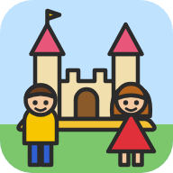
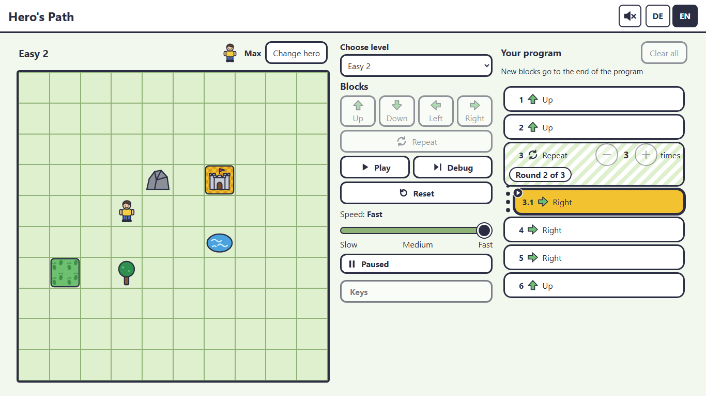
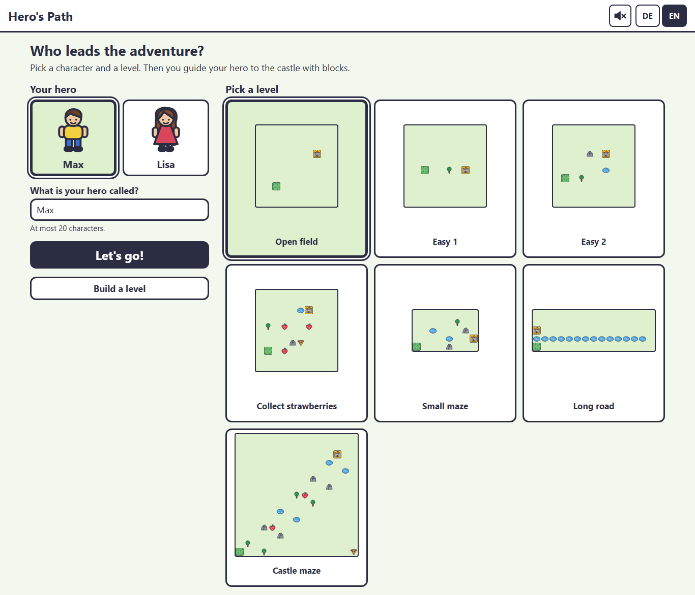
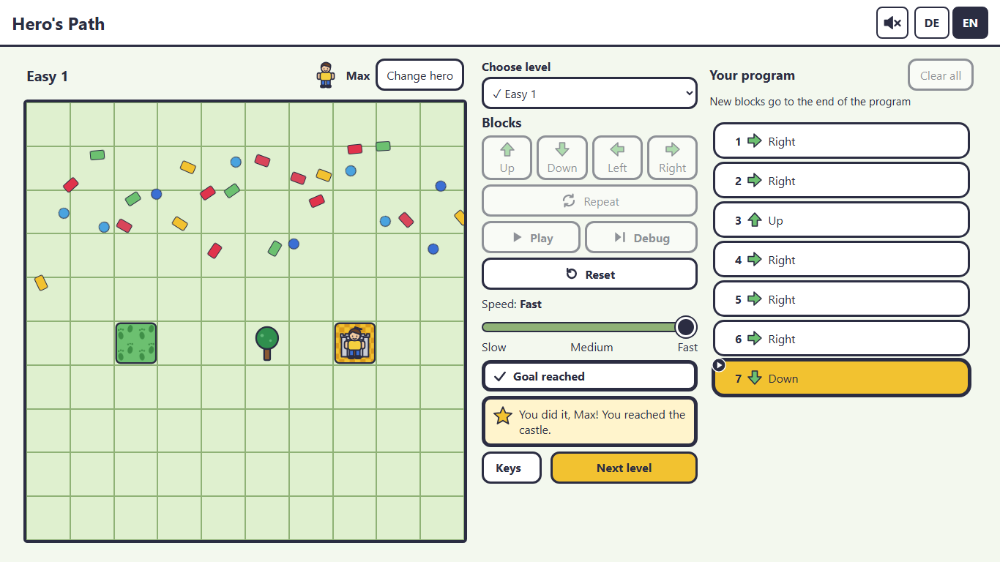
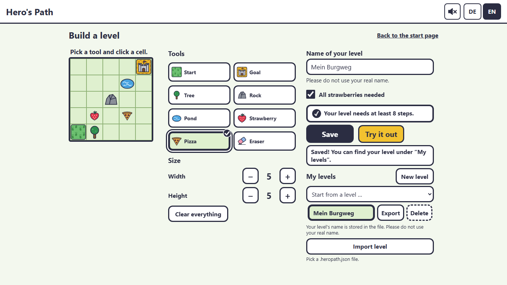
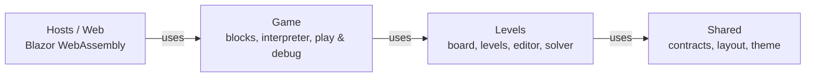

<div align="center">



# Hero's Path

**Program your hero to the castle, one block at a time.**

A coding game for kids aged 11 to 13. No installation, no account, no prior knowledge.

[](https://github.com/ramonafrick/HeroPath/actions/workflows/ci.yml)
[](https://github.com/ramonafrick/HeroPath/actions/workflows/pages.yml)

### [▶ Play now](https://ramonafrick.github.io/HeroPath/)

*Auf Deutsch heisst das Spiel «HeldenWeg». Es läuft in Deutsch und Englisch.*

</div>

<p align="center">
  
</p>

## What is it?

Max and Lisa want to get to the castle. Trees, rocks and ponds are in the way, and strawberries and pizza are waiting to be collected. Kids snap movement blocks into a program, press **Play** and watch their hero follow it step by step. When the hero bumps into a rock, the game says what went wrong and marks the block that caused it. Try again and fix it.

It was built for a *Zukunftstag*, a career-exploration day: kids aged 11 to 13 spend half a day, about four hours, in a software department. The goal is that they feel what programming is, on ordinary office laptops and without any setup.

## What kids learn

| Concept | How it shows up |
|---|---|
| **Sequences** | Up, Down, Left, Right blocks run in order |
| **Loops** | The *Repeat* block runs its blocks 1 to 20 times, nested up to two levels |
| **Debugging** | *Debug* runs one step at a time, highlights the current block and shows the loop round |
| **Problem solving** | Seven levels from an open field to a castle maze, plus levels they build themselves |

## Features

- 🧱 **Drag & drop blocks**, with a click alternative for every action
- 🐞 **Play and Debug**: watch the whole run, or step through it block by block, at three speeds
- 🏰 **Seven hand-made levels**, each checked by a solver to be solvable within the game limits
- 🍓 **Items to collect**: some levels only count when every strawberry is picked up
- 🛠️ **Level editor**: build your own board up to 20×20, see the shortest solution length, then play it. Export and import as `.heropath.json`
- 🎉 **Confetti on success**, and a calm golden frame when the system asks for reduced motion
- 🔊 **Sounds** for success, errors and items. Off by default, one click to turn on
- ⌨️ **Keyboard shortcuts**: arrows add blocks, Space plays, D steps, R resets
- 🌍 **German and English**, switchable at any time without losing the program
- 📲 **Installable app**: works offline after the first visit

<table>
  <tr>
    <td width="33%"></td>
    <td width="33%"></td>
    <td width="33%"></td>
  </tr>
  <tr>
    <td align="center"><b>Pick a hero and a level</b></td>
    <td align="center"><b>Reach the castle</b></td>
    <td align="center"><b>Build your own level</b></td>
  </tr>
</table>

## Made for kids, and for their privacy

- **Nothing about the child is stored.** The hero's name lives only in memory and is gone after a reload. It is never saved, logged or sent anywhere.
- **No accounts, no tracking, no ads, no external requests.** Fonts, graphics and scripts all ship with the app. A Content-Security-Policy keeps it that way.
- **All artwork is our own.** Max, Lisa, the castle and every tree are hand-written SVG.
- **Accessible by design.** Colour-blind-safe shapes and patterns, keyboard support, reduced motion and readable messages in kid-friendly language.

## Three ways to play

| Way | For | How |
|---|---|---|
| **Online** | Any browser | Open [ramonafrick.github.io/HeroPath](https://ramonafrick.github.io/HeroPath/) |
| **Installed app** | Edge or Chrome, offline use | Open the page once, then choose "Install" in the browser menu |
| **Offline ZIP** | Office laptops without internet | Download the ZIP from the [Package workflow](https://github.com/ramonafrick/HeroPath/actions/workflows/package.yml) (needs a GitHub login), unzip, double-click `Start.bat`. It needs no .NET and no internet |

## Under the hood

Hero's Path is a pure client-side app: C# compiled to WebAssembly, served as static files. No server, no database.

| | |
|---|---|
| **Platform** | .NET 10, C# 14, Blazor WebAssembly |
| **UI** | Razor components, CSS Grid, inline SVG, a few small JS modules for sound, keyboard and downloads. No UI framework |
| **Architecture** | Modular Clean Architecture, ready for a .NET MAUI host later |
| **Tests** | xUnit v3 on Microsoft Testing Platform, bUnit, Playwright for .NET, architecture tests |
| **Delivery** | GitHub Actions, GitHub Pages, own service worker, PowerShell static server for the ZIP |



Each module has a pure C# project (Domain, Application, Infrastructure) and a Razor UI library. Game rules live only in the Domain folders, and the platform (storage, downloads, sound, keyboard) sits behind interfaces that the host implements. Architecture tests check that dependencies only point one way.

**Quality gates on every push:**

- 1,400+ unit, component and architecture tests
- 100+ Playwright end-to-end flows on Windows, with screenshots in German and English, in colour and greyscale
- A separate check of the published site: Content-Security-Policy, deep links, offline reload, a solved level
- `dotnet format`, warnings as errors, every GitHub Action pinned to a commit SHA

The project is built with AI pair programming: the `.claude/` folder holds the skills and agents ([Claude Code](https://claude.com/claude-code)) that know the game rules, the architecture and the test conventions.

## Run it locally

You need the [.NET 10 SDK](https://dotnet.microsoft.com/download).

```bash
git clone https://github.com/ramonafrick/HeroPath.git
cd HeroPath
dotnet watch --project src/Hosts/HeroPath.Web
```

```bash
dotnet test --solution HeroPath.slnx                       # unit, bUnit and architecture tests
HEROPATH_E2E=1 dotnet test --project tests/HeroPath.E2E    # Playwright E2E, screenshots in artifacts/screenshots
```

## Documentation

The project documentation is in German:

- [Projektidee](docs/Projektidee.md): gameplay, blocks, messages, levels
- [Architektur (C4)](docs/Architektur%20C4.md): modules, components, decisions
- [Projektkontext](docs/Projekt_Kontext.md): decisions, limits, milestones

## License

[MIT](LICENSE) © 2026 ramonafrick
