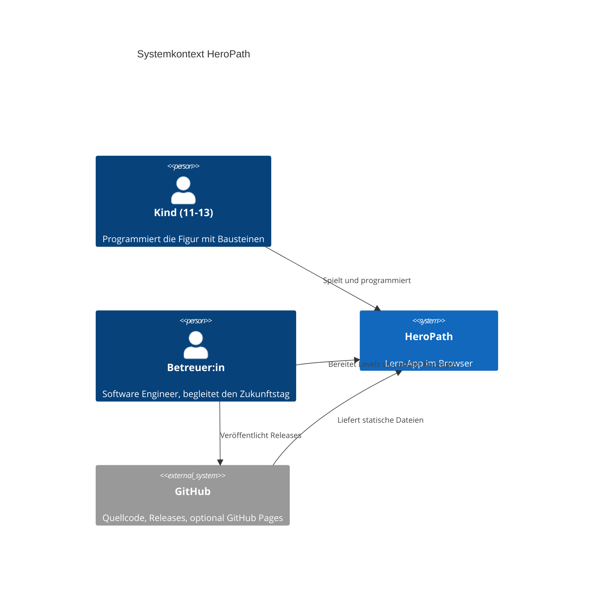
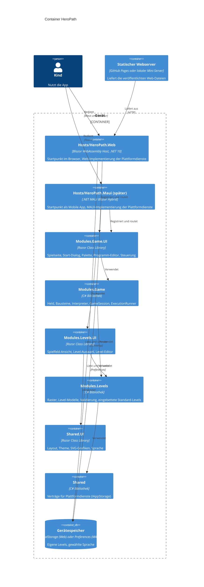
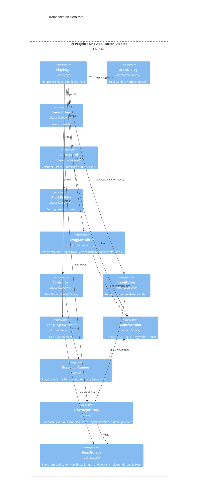
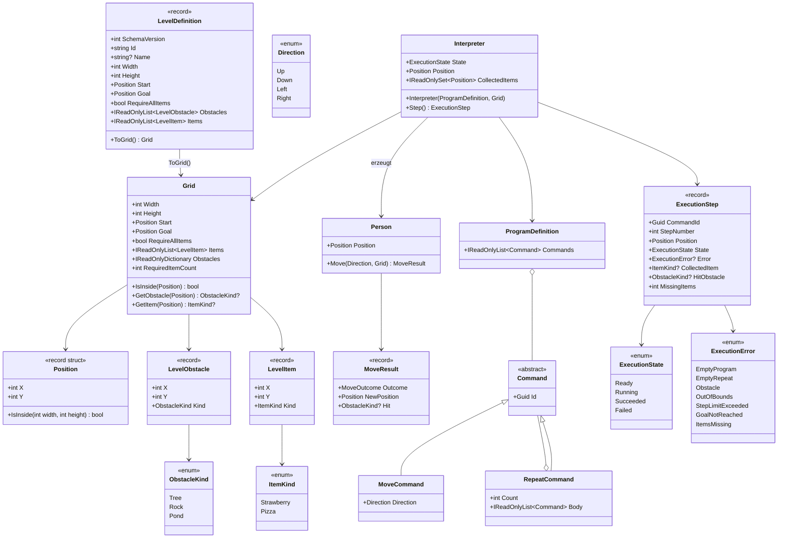
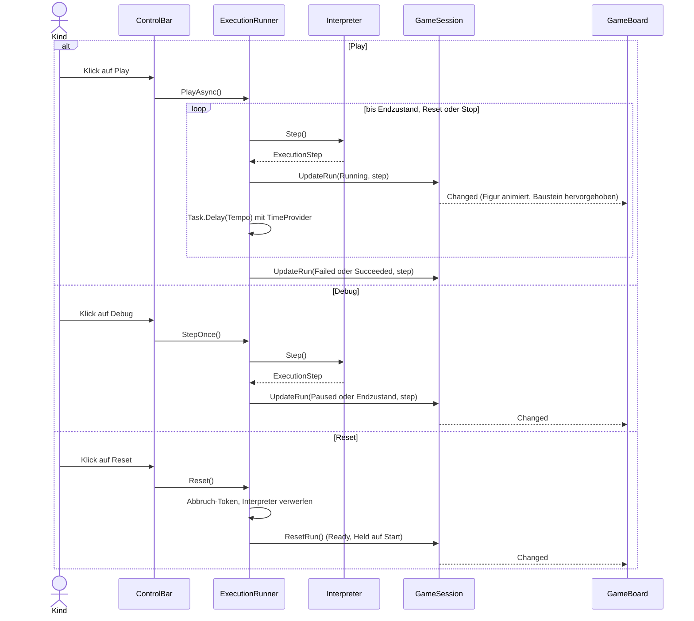
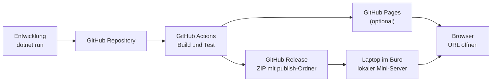

# HeroPath – Architektur (C4)

Die Diagramme sind in Mermaid geschrieben und werden auf GitHub direkt dargestellt.

## 1. Qualitätsziele

| Ziel | Massnahme |
|---|---|
| Einfach und robust im Einsatz | Keine Server, keine Anmeldung, alles läuft im Browser |
| Offline-fähig | Keine CDN-Abhängigkeiten, alle Assets liegen lokal |
| Testbar | Spielregeln in reinen C#-Projekten der Module ohne UI-Abhängigkeit, Grenzen per Architekturtest geprüft |
| Modular | Fachliche Module (Levels, Game) mit klarer Abhängigkeitsrichtung, nach Clean Architecture geschichtet |
| Austauschbar | Drag & Drop und Speicherung hinter eigenen Schnittstellen |
| Wiederverwendbar | Alle Komponenten in Razor Class Libraries, nutzbar im Browser und später in einer MAUI-App |
| Datenschutz | Der Heldenname wird nur im Arbeitsspeicher gehalten, nicht gespeichert |

## 2. Ebene 1: Systemkontext



## 3. Ebene 2: Container

HeroPath ist modular nach Clean Architecture aufgebaut (inspiriert von MiniMate):

- **Module** bündeln eine Fachlichkeit. Jedes Modul besteht aus zwei Projekten: einer reinen C#-Bibliothek mit den Ordnern `Domain`, `Application` und `Infrastructure` (ohne Blazor) und einer Razor Class Library `.UI` mit Komponenten, Texten und der Registrierung `Add<X>Module()`.
- **Shared** enthält modulübergreifende Verträge (`IAppStorage`) und UI (Layout, Theme, Grafiken, Sprache).
- **Hosts** starten die App und liefern die Plattformdienste. Heute gibt es den Web-Host, ein MAUI-Host kann später ergänzt werden, ohne Module zu ändern.

| Modul | Fachlichkeit |
|---|---|
| `Levels` | Spielfeld (Raster, Positionen, Hindernisse, Items), Level-Definitionen, Validierung, Standard-Levels, eigene Levels, Level-Editor |
| `Game` | Held, Bausteine, Programm, Interpreter, Play/Debug/Reset, Spielseite |

Abhängigkeitsrichtung: `Shared ← Levels ← Game`, für die `.UI`-Projekte gleich. Jedes `.UI`-Projekt kennt sein Modul, Hosts kennen alle `.UI`-Projekte. Reine Projekte referenzieren nie Blazor. `tests/HeroPath.ArchitectureTests` prüft diese Regeln automatisch.



## 4. Ebene 3: Komponenten

### 4.1 Komponenten und Dienste

Zuordnung zu den Projekten: `PlayPage`, `StartDialog`, `BlockPalette`, `ProgramEditor`, `ControlBar` liegen in `Modules.Game.UI`. `GameBoard`, `LevelPicker` und `LevelEditor` liegen in `Modules.Levels.UI`, `LanguageSwitcher` in `Shared.UI`. `GameSession` und `ExecutionRunner` liegen in `Modules.Game/Application`, `LevelRepository` in `Modules.Levels/Application`, `IAppStorage` in `Shared/Application/Contracts`.

**Stand nach M2:** Umgesetzt sind `PlayPage`, `GameSession`, `ExecutionRunner`, `GameBoard`, `BlockPalette`, `ProgramEditor` (nur Klick, kein Drag & Drop, keine Wiederhole-Blöcke), `ControlBar` (Play, Debug, Reset, Tempo, Status), `LanguageSwitcher` und `IAppStorage` (Web-Implementierung `LocalStorageAppStorage` im Host). Noch offen sind `StartDialog` (M4), `LevelPicker` (M4), `LevelEditor` (M5) und `LevelRepository` (M5). Bis dahin liest `PlayPage` das Demo-Level direkt über die statische Klasse `StandardLevels` (§6, Nr. 13).

Abweichungen des Ist-Stands vom Diagramm unten: `GameBoard` kennt keine Game-Typen und greift nicht auf die Session zu. Es bekommt `Grid`, Heldposition, markiertes Feld und Schrittdauer als Parameter von `PlayPage` und rendert die Figur über das `RenderFragment` `HeroContent`. `BlockPalette`, `ProgramEditor` und `ControlBar` lesen und ändern die `GameSession` direkt (`ControlBar` ruft zusätzlich den `ExecutionRunner` auf). `LanguageSwitcher` speichert die Sprache über `LanguageService` (Shared.UI), der `IAppStorage` verwendet.



### 4.2 Domain-Modell (Modules.Levels und Modules.Game)

Stand: Domain beider Module umgesetzt in M1. Der Lauf-Zustand darüber (`GameSession`, `ExecutionRunner`) kam in M2, siehe Unterabschnitt «Lauf-Zustand». `LevelRepository` fehlt noch.

`Position`, `ObstacleKind`, `ItemKind`, `LevelObstacle`, `LevelItem`, `Grid`, `LevelDefinition` und `LevelLimits` gehören zu `Modules.Levels/Domain`. Dazu kommen `LevelValidator`, `LevelValidationError`, `LevelValidationErrorKind` und `LevelReadResult` in `Modules.Levels/Application` sowie `LevelJson` (Lesen und Schreiben von Level-JSON, source-generierter `LevelJsonContext`) und `StandardLevels` (seit M2, eingebettete Levels) in `Modules.Levels/Infrastructure`. `Direction`, `Person`, `MoveResult`, die Befehle (`Command`, `MoveCommand`, `RepeatCommand`), `ProgramDefinition`, `Interpreter`, `ExecutionStep`, `ExecutionState`, `ExecutionError` und `ProgramLimits` gehören zu `Modules.Game/Domain`.

`Person` hält nur die `Position`. Heldenname und Avatar sind reiner UI-Zustand und gelangen nie in die Domain (Datenschutz). Der `Interpreter` erzeugt die `Person` selbst auf `Grid.Start`. Ein Reset bedeutet, einen neuen `Interpreter` zu erstellen.



`Command` ist eine geschlossene Hierarchie: Der Konstruktor ist `private protected`, ausserhalb der Game-Assembly kann niemand weitere Unterklassen ableiten. Der Interpreter muss deshalb nur `MoveCommand` und `RepeatCommand` kennen. `RepeatCommand` und `ProgramDefinition` prüfen ihre Grenzen im Konstruktor und kopieren die übergebene Liste.

`LevelDefinition` ist reine Daten (wie im JSON) und wird nicht beim Erstellen geprüft. `LevelValidator.Validate` liefert alle Regelverletzungen als Werte. `LevelJson.Read` verbindet Parsen und Validieren und gibt ein `LevelReadResult` zurück, nie eine Exception. `Grid` und `LevelDefinition.ToGrid()` werfen bei ungültigen Daten dagegen eine Exception (Schutznetz gegen Programmierfehler). `Grid` ist wertgleich (`IEquatable<Grid>`): Zwei Grids sind gleich, wenn Grösse, Start, Ziel, `RequireAllItems`, Hindernisse und Items übereinstimmen. `GameSession.Load` nutzt das.

**Semantik von `StepNumber`:**

- Bei `Obstacle`, `OutOfBounds` und `StepLimitExceeded` ist es die Nummer des versuchten Zuges (ausgeführte Züge + 1). Sie passt damit zur hervorgehobenen `CommandId`.
- In allen anderen Fällen ist es die Nummer des zuletzt ausgeführten Zuges.
- Bei `EmptyProgram` und `EmptyRepeat` ist es 0.

Der Schritt des letzten Zuges trägt bereits den Endzustand (`Succeeded`, oder `Failed` mit `GoalNotReached` bzw. `ItemsMissing`). Es gibt keinen zusätzlichen «Programm zu Ende»-Schritt. Weitere `Step()`-Aufrufe nach einem Endzustand liefern denselben End-Schritt.

#### Lauf-Zustand (Modules.Game/Application, seit M2)

`GameSession` (scoped, nur Arbeitsspeicher) hält das geladene `Grid`, das Programm (Liste von `MoveCommand`), den Lauf-Status, den letzten `ExecutionStep` (`CurrentStep`), das markierte Feld (`MarkedCell`) und das `Tempo`. Sie löst bei jeder Änderung `Changed` aus. Den Lauf-Status schreibt nur der `ExecutionRunner` (interne Methoden). `ExecutionRunner` (scoped) besitzt den `Interpreter` und die `CancellationTokenSource` des laufenden Play. Beide sind reines C# und kennen kein Blazor. Der Runner bekommt einen `TimeProvider` (`TimeProvider.System` ist in `AddGameModule()` registriert), damit Tests die Wartezeit ohne echte Zeit steuern.

| Typ | Werte / Regel |
|---|---|
| `RunStatus` | `Ready` (nichts ausgeführt, Programm editierbar), `Running` (Play läuft), `Paused` (Debug-Schritt gemacht oder Play gestoppt), `Failed`, `Succeeded` (Endzustände) |
| `Tempo` | `Slow` 900 ms, `Medium` 500 ms (Standard), `Fast` 200 ms. Liegt in `GameSession`, Änderung wirkt auf die nächste Wartezeit. Die Board-Animation verwendet dieselbe Dauer |
| `IsEditable` | Nur bei `Ready`. Ab dem ersten Schritt bis Reset sind Hinzufügen, Entfernen und Leeren gesperrt |
| `CanStart` | Eine einzige Startregel in `ExecutionRunner`: Grid geladen, Programm nicht leer, Status `Ready` oder `Paused`. Gilt für Play und Debug, `ControlBar` sperrt die Knöpfe damit |

Operationen des Runners:

- **`PlayAsync`:** Führt den ersten Schritt sofort aus, wartet danach `Tempo.Duration` und macht weiter, bis ein Endzustand erreicht ist oder abgebrochen wird. Läuft in `try/finally`: Bricht eine Ausnahme die Schleife ab, wird `Running` zu `Paused`, die Ausnahme wird weitergereicht.
- **`StepOnce` (Debug):** Genau ein `Step()`, danach `Paused` (oder `Failed`/`Succeeded`). Ein späteres Play setzt mit demselben Interpreter fort.
- **`Stop`:** Bricht ein laufendes Play ab und lässt den Lauf `Paused`: Interpreter, Position und Programm bleiben. Kein Knopf der Oberfläche, nur `PlayPage` ruft es beim Verlassen der Seite auf.
- **`Reset`:** Bricht Play ab, verwirft den Interpreter und setzt Status und Schritt zurück (`Ready`, Held auf Start). Das Programm bleibt, das Tempo bleibt.
- **`GameSession.Load(Grid)`:** Ein gleiches Grid (Wertgleichheit) ändert nichts. Ein anderes Grid verwirft den Lauf (der Runner bekommt `RunDiscarded` und lässt Interpreter und Abbruch fallen), setzt `Ready` und behält das Programm.

Markiertes Feld bei einem Fehlerschritt: bei `Obstacle` das Hindernisfeld (Position des Helden plus Richtung des Bausteins), bei `OutOfBounds` das Feld, auf dem der Held stehen bleibt.

### 4.3 MAUI-Bereitschaft (Plattform-Abstraktion)

Die Oberfläche wird so gebaut, dass später ein .NET-MAUI-Blazor-Hybrid-Projekt (`Hosts/HeroPath.Maui`) angehängt werden kann. Es registriert dieselben Module (`AddSharedUI().AddLevelsModule().AddGameModule()`). Das MAUI-Projekt enthält dann nur den Startcode und die MAUI-Implementierungen der Plattformdienste. Es wird erst nach dem Zukunftstag umgesetzt.

| Thema | Web (heute) | MAUI (später) | Abstraktion |
|---|---|---|---|
| Speicher | localStorage über JS Interop | Preferences oder Dateisystem | `IAppStorage` |
| Standard-Levels | Eingebettete JSON-Ressourcen in `Modules.Levels` | gleich | keine nötig |
| Sprache | `CultureInfo` plus `IAppStorage` | gleich | `IAppStorage` |
| Level-Export und -Import | Datei-Download per JS | Teilen oder Dateiauswahl | `ILevelFileService` (Could) |
| Bedienung | Maus, HTML5 Drag & Drop | Touch im WebView | Klick-zum-Hinzufügen als Alternative |
| Layout | Desktop-first | Hochformat, kleine Bildschirme | Responsives CSS |
| Start | `index.html` mit Webserver | `BlazorWebView` | nur im Host-Projekt |

**Regeln für Komponenten:**

1. Alle Komponenten, Styles, Grafiken und Texte liegen in den `.UI`-Projekten der Module oder in `Shared.UI`. Die Hosts enthalten nur Startcode, die Registrierung der Module und die Plattformdienste.
2. Komponenten greifen nie direkt auf `localStorage`, `window`, das Dateisystem oder relative `HttpClient`-Adressen zu. Sie verwenden die Schnittstellen.
3. Jede Drag-&-Drop-Aktion hat eine Alternative per Klick oder Tipp. HTML5 Drag & Drop ist auf Touch-Geräten im WebView unzuverlässig.
4. Das Layout ist responsiv (CSS Grid, relative Einheiten, Container Queries), keine festen Pixelbreiten. Tippflächen sind mindestens 44 px gross.
5. Statische Dateien werden über den Pfad `_content/<Projektname>/...` eingebunden, z. B. `_content/HeroPath.Shared.UI/css/theme.css`.
6. Die reinen Projekte (`Shared`, `Modules.Levels`, `Modules.Game`) bleiben ohne Plattform- und Blazor-Abhängigkeit.

Hinweise: Der iOS-Build braucht einen Mac. Ob Fluent UI Blazor im Hybrid-Betrieb alle verwendeten Komponenten unterstützt, wird beim Anhängen des MAUI-Hosts geprüft. Der Start mit `Blazor.start` samt `loadAllSatelliteResources` (§6, Nr. 11) betrifft nur den Web-Host (`index.html`).

## 5. Ablauf: Play, Debug und Reset

Play und Debug verwenden denselben Interpreter. Play ruft `Step()` in einer Schleife auf (erster Schritt sofort, danach Wartezeit gemäss Tempo), Debug ruft es einmal pro Klick auf. Der Runner meldet jeden Schritt an die `GameSession` (`UpdateRun`), die `Changed` auslöst. Die Komponenten rendern sich neu: `GameBoard` bewegt die Figur per CSS-Transition, `ProgramEditor` hebt den Baustein hervor, `ControlBar` zeigt den Status.



Abweichungen vom ursprünglichen Entwurf (`Run(tempo)`, `Apply(step)`): Das Tempo liest der Runner aus der `GameSession`, es wird nicht übergeben. Statt eines «Endstatus»-Rückgabewerts steht der Status in der Session. Die Sperrregel `CanStart` gilt für beide Pfade. Beim Verlassen der Seite ruft `PlayPage` `Stop()` auf (Status `Paused`, kein Reset).

## 6. Entscheidungen

| Nr. | Entscheidung | Begründung | Alternative |
|---|---|---|---|
| 1 | Blazor WebAssembly, rein clientseitig | Kein Server nötig, läuft lokal und auf GitHub Pages | Blazor Server |
| 2 | Modulare Clean Architecture: Module `Levels` und `Game` plus `Shared`, je ein reines C#-Projekt (`Domain`/`Application`/`Infrastructure`) und ein `.UI`-Projekt | Fachliche Grenzen, Spielregeln ohne UI testbar, Erweiterung um neue Module (z. B. Themenwelten) ohne Umbau. Inspiriert von MiniMate, aber mit Fachlogik ausserhalb von Razor-Projekten | Drei Schichten Core/UI/Web; ein Razor-Projekt pro Modul (wie MiniMate); vier Projekte pro Modul |
| 2a | Oberfläche in Razor Class Libraries, Hosts nur zum Starten | Gleiche Komponenten im Browser und später in MAUI | Komponenten direkt im Web-Projekt |
| 2b | Abhängigkeitsregeln als automatischer Test (`HeroPath.ArchitectureTests`, liest DLL-Metadaten) | Grenzen bleiben auch bei KI-generiertem Code eingehalten | Nur Code-Review; NetArchTest-Paket |
| 3 | Ein Interpreter für Play und Debug | Weniger Code, gleiches Verhalten | Zwei getrennte Ausführungswege |
| 3a | Geschlossene Befehlshierarchie: abstrakte Klasse `Command` mit `private protected`-Konstruktor, nur `MoveCommand` und `RepeatCommand` | Der Interpreter kennt alle Fälle, kein unbekannter Befehlstyp von aussen. Gemeinsame `Id` in der Basisklasse | Interface `ICommand` (ursprünglicher Entwurf in §4.2): offen für beliebige Implementierungen, der Interpreter bräuchte einen Fallback für unbekannte Typen |
| 3b | `Person` hält nur die `Position`, ohne Name und Avatar. Der `Interpreter` erzeugt die `Person` selbst auf `Grid.Start` | Datenschutz: Der Heldenname gelangt nie in die Domain (Logs, `ToString()`, Exceptions). Name und Avatar sind UI-Zustand. Der Held beginnt immer auf dem Start | `Person` mit `Name` und `Avatar` und `Interpreter(program, grid, person)` wie im ursprünglichen §4.2 |
| 4 | Native HTML5 Drag & Drop in eigener Komponente, dazu Klick-zum-Hinzufügen | Keine Abhängigkeit, Maus genügt heute, Klick funktioniert auch auf Touch | SortableJS-Wrapper, MudBlazor DropZone, Blockly, Pointer Events |
| 5 | Raster mit CSS Grid, Figuren und Items als SVG | Einfach, skalierbar, Animation mit CSS-Transitions | Canvas |
| 6 | Fluent UI nur für Dialoge, Auswahl, Slider, Buttons | Bekannt, wenig Aufwand, eigenes verspieltes Styling darüber | Reines eigenes CSS |
| 7 | Lokalisierung mit `IStringLocalizer` und resx (de, en), inkl. Anzeigename (HeldenWeg / Hero's Path) | Standard in .NET | Eigene JSON-Texte |
| 8 | Level als JSON, Standard-Levels als eingebettete Ressourcen in `Modules.Levels` | Lesbar, exportierbar, funktioniert in jedem Host | Dateien in `wwwroot` per HttpClient |
| 9 | Speicherung hinter `IAppStorage`, Web-Implementierung mit localStorage | Reicht für den Einsatz, MAUI kann eigene Implementierung liefern | Keine Speicherung |
| 10 | E2E-Tests mit Playwright für .NET, Screenshots (normal und Graustufen) werden von einem Agenten visuell geprüft | Reproduzierbar, läuft in CI, ohne Node; prüft Layout und Farbenblind-Tauglichkeit | Nur manuell im Browser; Playwright MCP; nativer VS-Code-Browser (nur für Copilot steuerbar) |
| 11 | Sprachwechsel ohne Neuladen: Alle Satellite-Assemblies werden beim Start geladen (`autostart="false"` und `Blazor.start` mit `configureRuntime` → `withConfig({ loadAllSatelliteResources: true })` in `index.html`) | Blazor WebAssembly lädt die Satellite-Assemblies (resx `en`) sonst nur für die beim Start aktive Kultur, der Wechsel zeigte still weiter Deutsch (bUnit läuft auf der .NET-Runtime und merkt das nicht). Ein Neuladen würde Programm, Lauf und Heldenname (nur im Speicher) verlieren (FR19). Nachteil: Das Flag steht nicht in der öffentlichen `dotnet.d.ts`, der Runtime-Loader liest es aber. Eine neue .NET-Version könnte es ändern. `LanguageTests` (E2E, Wechsel ohne Neuladen) sichert es ab | Neuladen der Seite nach dem Wechsel (`forceLoad: true`, Ansatz in Microsoft Learn «Blazor globalization and localization», Abschnitt «Dynamically set the client-side culture by user preference»; verliert den Zustand); vor `RunAsync` `CurrentCulture` und `CurrentUICulture` verschieden setzen, damit `WebAssemblyCultureProvider.GetCultures` beide Kulturen lädt (stützt sich ebenfalls auf internes Verhalten, schwerer verständlich). Quellen: `WebAssemblyCultureProvider.cs` in `dotnet/aspnetcore`, `loader/assets.ts` in `dotnet/runtime`, Microsoft Learn «Blazor startup», Abschnitt «Configure the .NET WebAssembly runtime» |
| 12 | `FakeTimeProvider` aus dem Paket `Microsoft.Extensions.TimeProvider.Testing` (Version 10.11.0), nur im Game-Testprojekt | Offizielles Microsoft-Hilfspaket, keine Mocking-Bibliothek. `FakeTimeProvider.Advance()` steuert `Task.Delay(…, timeProvider, token)` korrekt, Tests laufen ohne echte Wartezeit. Keine neue Abhängigkeit in `src/` | Eigener Fake im Testprojekt: `CreateTimer` samt `ITimer` müsste nachgebaut werden, fehleranfällig |
| 13 | `StandardLevels` als statische Klasse in `Modules.Levels/Infrastructure` (liest eingebettete `Levels/*.json`, `All`, `Get(id)`), kein `ILevelSource` und kein `LevelRepository` bis M5 | Ein einziges Level, nur eine Quelle. Interface, eingebettete Quelle und Repository wären drei Typen auf Vorrat. `LevelRepository` (§4.1) bleibt Zielarchitektur und kommt mit M5, wenn eigene Levels über `IAppStorage` dazukommen | `ILevelSource` (Application/Contracts) mit `EmbeddedLevelSource` und `LevelRepository` sofort |
| 14 | Verlassen der Spielseite stoppt Play (`Stop`, Status `Paused`) statt Reset | Keine Schleife läuft im Hintergrund weiter. Kommt das Kind zurück (gleiches Grid, `Load` ändert nichts), sind Programm, Position und Interpreter noch da und Play oder Debug setzen fort | Reset beim Verlassen: einfacher, aber der Lauf geht verloren; Schleife weiterlaufen lassen: Zustandsänderungen und mögliche Ausnahmen auf einer nicht mehr angezeigten Seite |

## 7. Deployment



Wichtig: Eine Blazor-WebAssembly-App läuft nicht per Doppelklick auf `index.html` (`file://`). Sie braucht einen Webserver. Optionen für den lokalen Einsatz:

1. **GitHub Pages** (kein Install, nur URL öffnen, falls das Netz es zulässt).
2. **Mini-Host** (kleines ASP.NET-Core-Projekt, das nur statische Dateien ausliefert, als selbständige EXE mit `Start.bat`).
3. **Beliebiger statischer Server**, z. B. `python -m http.server` im publish-Ordner.

## 8. Teststrategie

| Ebene | Werkzeug | Inhalt |
|---|---|---|
| Domain/Application (`HeroPath.Modules.<X>.Tests`) | xUnit | Bewegung, Hindernisse, Rand, Wiederhole (auch verschachtelt), Items, Ziel, Schrittlimit, Level-Validierung, Lösbarkeit der Standard-Levels; `GameSession` und `ExecutionRunner` mit `FakeTimeProvider` |
| Komponenten (`HeroPath.Modules.<X>.Tests`, `HeroPath.Shared.Tests`) | bUnit | `ProgramEditor` (Bausteine hinzufügen, entfernen, verschachteln), `ControlBar`, `GameBoard` Darstellung, Sprachumschaltung |
| Architektur (`HeroPath.ArchitectureTests`) | xUnit | Abhängigkeitsrichtung der Module, reine Projekte ohne Blazor |
| End-to-End (`HeroPath.E2E`) | Playwright (.NET) | Abläufe über mehrere Komponenten, Browserfehler, Screenshots für den visuellen Check. Läuft nur mit `HEROPATH_E2E=1` |
| Manuell | Browser | Drag & Drop, Animation, Probelauf auf dem Ziel-Laptop |

## 9. Ordnerstruktur

Im Root liegen nur `README.md`, die Solution-Datei `HeroPath.slnx` und die Repo-Dateien. Der Code liegt in `src/` und `tests/`, die Dokumentation in `docs/`.

```text
HeroPath/
├─ README.md                  Kurzbeschreibung, Start, Build, Lizenz
├─ HeroPath.slnx              Solution (XML-Format, Standard ab .NET 10 SDK)
├─ LICENSE                    MIT
├─ .gitignore
├─ Directory.Build.props      Gemeinsame Build-Einstellungen
├─ Directory.Packages.props   Zentrale Paketversionen
├─ src/
│  ├─ Shared/
│  │  ├─ HeroPath.Shared/              Verträge für Plattformdienste (IAppStorage, StorageKeys)
│  │  └─ HeroPath.Shared.UI/           Layout, NotFound, Theme, SVG-Grafiken (Graphics), Sprache, LanguageSwitcher
│  ├─ Modules/
│  │  ├─ Levels/
│  │  │  ├─ HeroPath.Modules.Levels/     Domain, Application, Infrastructure (eingebettete Standard-Levels, StandardLevels)
│  │  │  └─ HeroPath.Modules.Levels.UI/  Spielfeld-Ansicht (GameBoard), später Level-Auswahl und Level-Editor, Texte
│  │  └─ Game/
│  │     ├─ HeroPath.Modules.Game/       Domain (Held, Bausteine, Interpreter), Application (GameSession, ExecutionRunner, RunStatus, Tempo)
│  │     └─ HeroPath.Modules.Game.UI/    Spielseite, Palette, Programm-Editor, Steuerung, Texte
│  └─ Hosts/
│     ├─ HeroPath.Web/                 Blazor WebAssembly Host (Program.cs, App.razor, index.html, Web-Dienste)
│     ├─ HeroPath.Maui/                (später) MAUI Blazor Hybrid Host
│     └─ HeroPath.Host/                (optional) Mini-Webserver für den lokalen Einsatz
├─ tests/
│  ├─ HeroPath.Shared.Tests/           xUnit + bUnit (Sprache, LanguageSwitcher, Grafiken)
│  ├─ HeroPath.Modules.Levels.Tests/   xUnit + bUnit
│  ├─ HeroPath.Modules.Game.Tests/     xUnit + bUnit, FakeTimeProvider
│  ├─ HeroPath.Testing/                Gemeinsame Test-Hilfen (InMemoryAppStorage, ThrowingAppStorage, CultureScope, CultureBunitContext), keine Tests
│  ├─ HeroPath.ArchitectureTests/      Abhängigkeitsregeln
│  └─ HeroPath.E2E/                    Playwright, Screenshots nach artifacts/screenshots
└─ docs/
   ├─ Projektidee.md
   ├─ Architektur C4.md
   ├─ Projekt_Kontext.md
   ├─ requirements.md, plan.md         Anforderung und Plan des aktuellen Meilensteins (M2)
   └─ requirements-M1.md, plan-M1.md   Anforderung und Plan von M1
```
