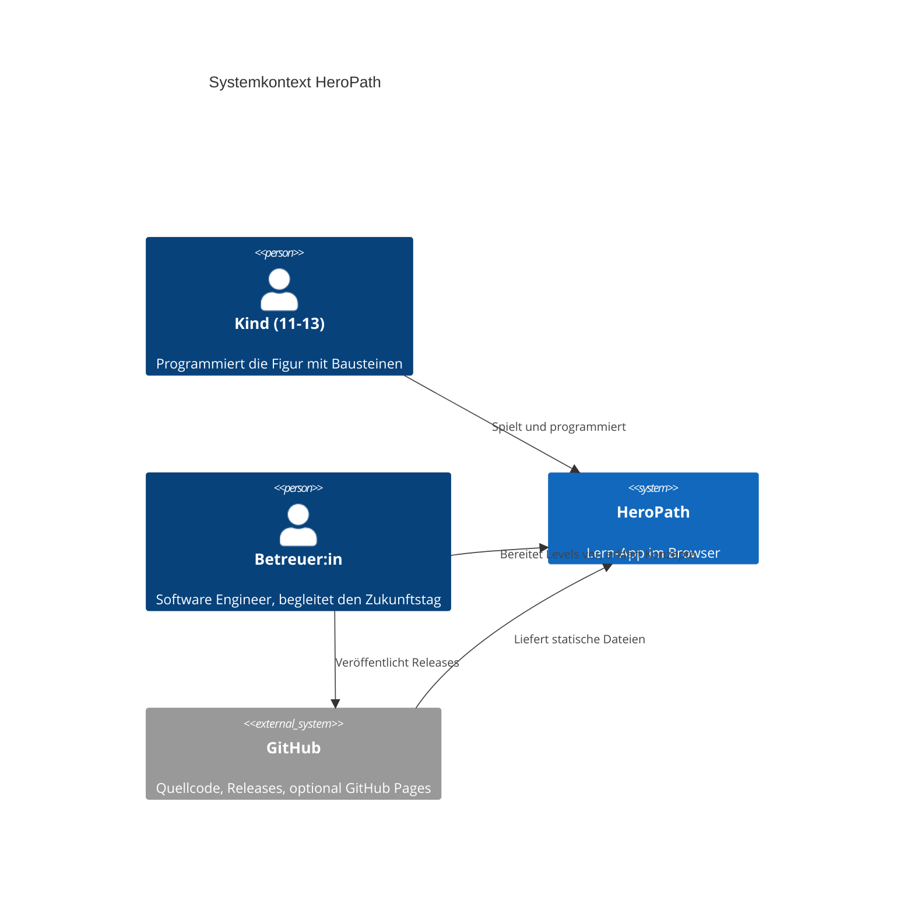
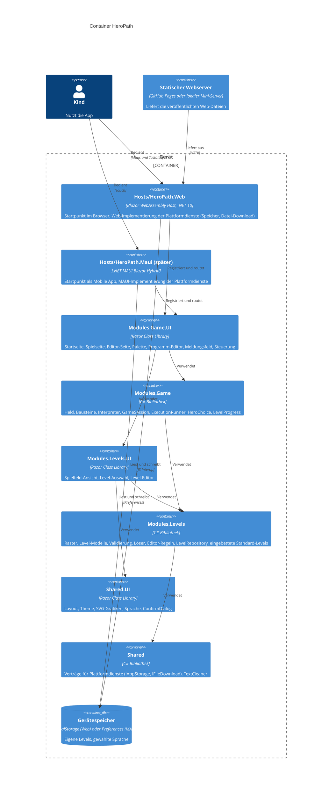
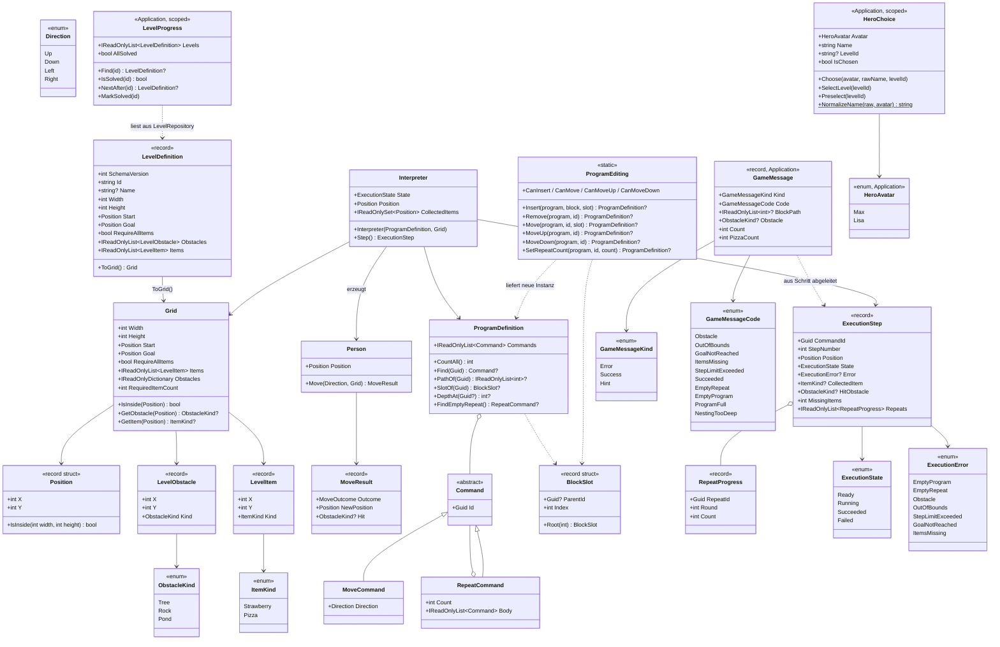
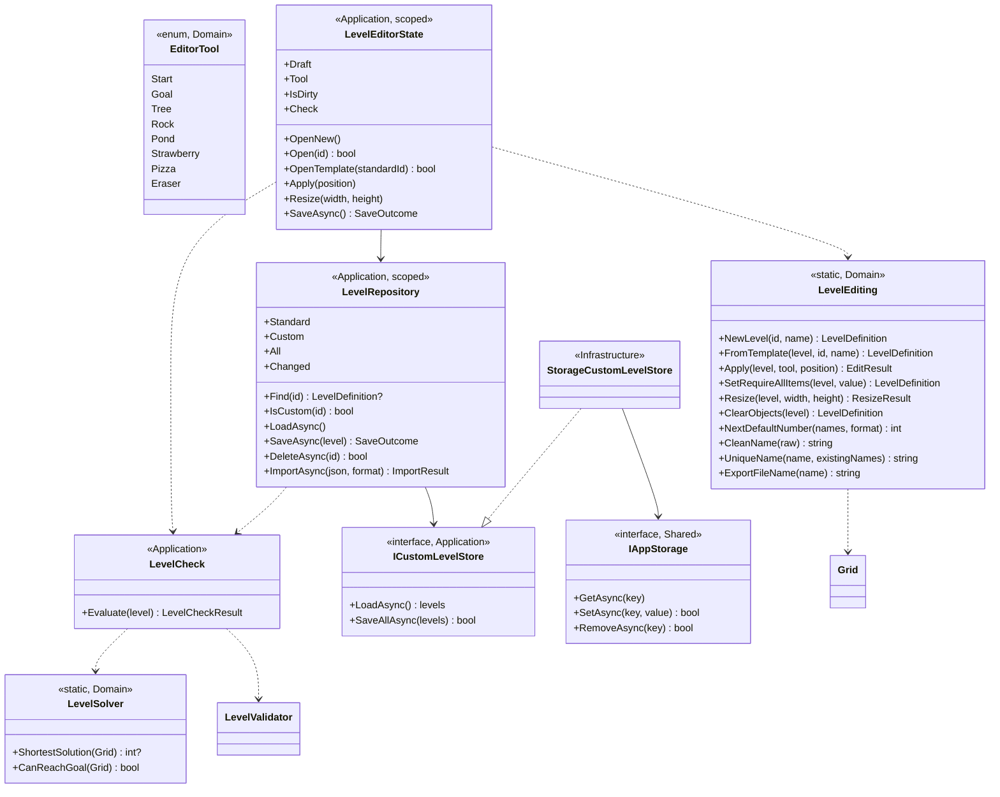
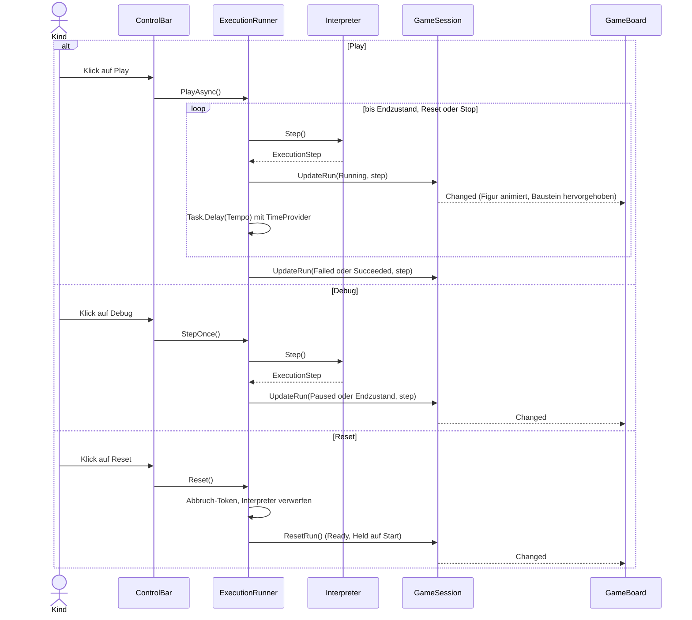
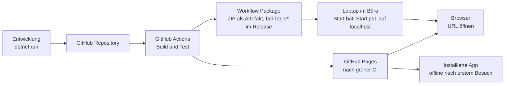

# HeroPath – Architektur (C4)

Die Diagramme sind in Mermaid geschrieben und werden auf GitHub direkt dargestellt.

## 1. Qualitätsziele

| Ziel | Massnahme |
|---|---|
| Einfach und robust im Einsatz | Keine Server, keine Anmeldung, alles läuft im Browser |
| Offline-fähig | Keine CDN-Abhängigkeiten, alle Assets liegen lokal |
| Testbar | Spielregeln in reinen C#-Projekten der Module ohne UI-Abhängigkeit, Grenzen per Architekturtest geprüft |
| Modular | Fachliche Module (Levels, Game) mit klarer Abhängigkeitsrichtung, nach Clean Architecture geschichtet |
| Austauschbar | Drag & Drop und Speicherung hinter eigenen Schnittstellen |
| Wiederverwendbar | Alle Komponenten in Razor Class Libraries, nutzbar im Browser und später in einer MAUI-App |
| Datenschutz | Der Heldenname wird nur im Arbeitsspeicher gehalten, nicht gespeichert |

## 2. Ebene 1: Systemkontext



## 3. Ebene 2: Container

HeroPath ist modular nach Clean Architecture aufgebaut (inspiriert von MiniMate):

- **Module** bündeln eine Fachlichkeit. Jedes Modul besteht aus zwei Projekten: einer reinen C#-Bibliothek mit den Ordnern `Domain`, `Application` und `Infrastructure` (ohne Blazor) und einer Razor Class Library `.UI` mit Komponenten, Texten und der Registrierung `Add<X>Module()`.
- **Shared** enthält modulübergreifende Verträge (`IAppStorage`, `IFileDownload`) und UI (Layout, Theme, Grafiken, Sprache, `ConfirmDialog`).
- **Hosts** starten die App und liefern die Plattformdienste. Heute gibt es den Web-Host, ein MAUI-Host kann später ergänzt werden, ohne Module zu ändern.

| Modul | Fachlichkeit |
|---|---|
| `Levels` | Spielfeld (Raster, Positionen, Hindernisse, Items), Level-Definitionen, Validierung, Löser, Standard-Levels, eigene Levels (Repository, Speicher), Level-Editor |
| `Game` | Held, Bausteine, Programm, Interpreter, Play/Debug/Reset, Startseite, Spielseite, Editor-Seite (hostet den `LevelEditor` aus `Levels.UI`) |

Abhängigkeitsrichtung: `Shared ← Levels ← Game`, für die `.UI`-Projekte gleich. Jedes `.UI`-Projekt kennt sein Modul, Hosts kennen alle `.UI`-Projekte. Reine Projekte referenzieren nie Blazor. `tests/HeroPath.ArchitectureTests` prüft diese Regeln automatisch.



## 4. Ebene 3: Komponenten

### 4.1 Komponenten und Dienste

Zuordnung zu den Projekten: `StartPage`, `PlayPage`, `EditorPage`, `HeroBadge`, `HeroFigure`, `ItemCounter`, `BlockPalette`, `ProgramEditor`, `MessageBox`, `ControlBar` liegen in `Modules.Game.UI`. `GameBoard`, `LevelPicker` und `LevelEditor` (mit `EditorToolbar`, `EditorSizeControl`, `EditorStatus`, `CustomLevelList`, `EditorLevelFiles`) liegen in `Modules.Levels.UI`, `LanguageSwitcher` und `ConfirmDialog` in `Shared.UI`. `GameSession`, `ExecutionRunner`, `HeroChoice` und `LevelProgress` liegen in `Modules.Game/Application`, `LevelRepository` und `LevelEditorState` in `Modules.Levels/Application`, `IAppStorage` und `IFileDownload` in `Shared/Application/Contracts`.

**Stand nach M2:** Umgesetzt sind `PlayPage`, `GameSession`, `ExecutionRunner`, `GameBoard`, `BlockPalette`, `ProgramEditor` (nur Klick, kein Drag & Drop, keine Wiederhole-Blöcke), `ControlBar` (Play, Debug, Reset, Tempo, Status), `LanguageSwitcher` und `IAppStorage` (Web-Implementierung `LocalStorageAppStorage` im Host). Noch offen sind `StartDialog` (M4), `LevelPicker` (M4), `LevelEditor` (M5) und `LevelRepository` (M5). Bis dahin liest `PlayPage` das Demo-Level direkt über die statische Klasse `StandardLevels` (§6, Nr. 13).

**Stand nach M3:** Neu oder erweitert in `Modules.Game.UI`:

- `ProgramEditor` ist die Hülle um die rekursive Programmliste: `BlockList` rendert die Bausteine einer Ebene, `ProgramBlock` einen einzelnen Baustein (Bewegung oder Wiederhole mit eigenem `BlockList` für den Rumpf), `DropZone` die Einfügestelle vor jedem Baustein und am Listenende. `ProgramBlock` zeigt Nummer, Auswahl, ▲▼🗑, −/+, die Runde («Runde 2 von 3») und die Markierungen für aktuell, Fehler und Hinweis.
- `BlockPalette` kennt jetzt «Wiederhole», ist Quelle des Ziehens und Löschziel für Programm-Bausteine.
- `MessageBox` zeigt `GameSession.Message` mit Symbol je Art und übersetzt jeden `GameMessageCode` in genau einen resx-Schlüssel. Der Heldenname ist dort die feste Konstante «Max» (bis M4).
- `ProgramDragState` (Ordner `Services`, scoped) hält, was gezogen wird (`DragSource`: neuer Bewegungs-Baustein, neuer Wiederhole-Block oder bestehender Baustein). Er enthält keine Regeln, sondern fragt `GameSession`.
- `ProgramIcon` zeichnet die kleinen Symbole (Wiederhole, ▲, ▼, Papierkorb, −, +).
- Basisklassen: `SessionComponentBase` (Sprache und Session) und `DragAwareComponentBase` (zusätzlich `ProgramDragState`).

**Stand nach M4:** Die Startseite ist eine eigene Seite (`StartPage`, Route `/`), nicht der in M2 geplante modale `StartDialog`. Die Spielseite liegt auf `/play`. Neu oder erweitert:

- `Modules.Game.UI`:
  - `StartPage` (`/`): Heldenkarten Max und Lisa (`aria-pressed`), Namensfeld (höchstens 20 Zeichen), die sieben Level als Karten mit Vorschau und Haken für gelöste, Knopf «Los!». Das Formular hält seinen Zustand in der Komponente (ein Sprachwechsel behält ihn) und wird beim Öffnen aus `HeroChoice` vorbelegt. «Los!» ruft `HeroChoice.Choose` und navigiert relativ nach `play`, es lädt kein Level.
  - `PlayPage` (`/play`): Lädt das Level aus `HeroChoice.LevelId` über `LevelProgress.Find` in die `GameSession`. Ohne Wahl leitet sie mit `NavigateTo("", replace: true)` auf `/` um. Sie zeigt zusätzlich zum Kopf den `ItemCounter`, oben in den Werkzeugen den `LevelPicker` und nach einem Erfolg den Knopf «Nächstes Level» (nicht im letzten Level).
  - `HeroBadge` (Bild, Name, «Held wechseln» im Kopf), `HeroFigure` (zeichnet Max oder Lisa nach `HeroAvatar`), `ItemCounter` (ein Zähler je im Level vorkommender Item-Art).
  - `MessageBox` setzt den Namen aus `HeroChoice.Name` ein statt der Konstante «Max», nennt gefundene Pizza-Stücke (`GameMessage.PizzaCount`) und ergänzt bei `LevelProgress.AllSolved` «Du hast alle Level geschafft!».
- `Modules.Levels.UI`:
  - `LevelPicker`: natives `<select>` mit «✓ » vor gelösten Leveln. Er bekommt Level, gewählte Id, die Gelöst-Abfrage und einen `EventCallback<string>` als Parameter und kennt weder `LevelProgress` noch Game-Typen.
  - `GameBoard` hat zwei neue Parameter: `CollectedItems` (eingesammelte Items bleiben mit `data-collected` im DOM und blenden aus) und `Preview` (kleines, dekoratives Bild ohne Held, `aria-hidden`, Grösse vom Container).
- `Modules.Game/Application`:
  - `HeroChoice` (scoped): `Avatar` (`HeroAvatar`: `Max`, `Lisa`), `Name`, `LevelId`, `IsChosen`, `Choose`, `SelectLevel`, statisch `DefaultName`, `NormalizeName`, `NameAfterSwitch`. Nur Arbeitsspeicher, `Changed` wird nicht abonniert.
  - `LevelProgress` (scoped, in M4 mit `StandardLevels.All` erzeugt, seit M5 aus dem `LevelRepository`): `Levels`, `Find`, `IsSolved`, `AllSolved`, `NextAfter`, `MarkSolved`, `Changed`. Nur Arbeitsspeicher.
  - `GameSession.Load(LevelDefinition)` ersetzt `Load(Grid)`, dazu `Level` und `CollectedItems`. `ExecutionRunner` hat den Konstruktor `ExecutionRunner(GameSession, LevelProgress, TimeProvider)` und markiert ein Level bei `Succeeded` als gelöst. `GameMessage` hat das Feld `PizzaCount`.
- `Shared.UI/Graphics`: `HeroLisa`, `ItemStrawberry`, `ItemPizza`.
- Fluent UI wird nicht verwendet (§6, Nr. 24).

**Stand nach M5:** Der Level-Editor und die Speicherung eigener Levels sind gebaut. Neu oder erweitert:

- `Modules.Levels` (Domain, Application, Infrastructure): `LevelSolver`, `LevelEditing`, `EditorTool`, `LevelCheck`, `LevelEditorState`, `LevelRepository`, `LevelIdGenerator`, `ICustomLevelStore` mit `StorageCustomLevelStore`. Details in §4.2 («Editor und eigene Levels»).
- `Modules.Levels.UI`:
  - `LevelEditor` (`data-testid="level-editor"`, Parameter `LevelId`): Werkzeugleiste (`EditorToolbar`), Grösse (`EditorSizeControl`), Name, Schalter «Alle Erdbeeren nötig», Prüfanzeige (`EditorStatus`), Speichern, «Ausprobieren», «Alles leeren», Vorlage, Liste «Meine Levels» (`CustomLevelList`), Export und Import (`EditorLevelFiles`). Er zeigt die Rückfragen über den `ConfirmDialog` und schützt den Entwurf mit einem `NavigationLock` (§6, Nr. 32). Aller Zustand liegt in `LevelEditorState`, ein Sprachwechsel oder ein neues Rendern verliert nichts.
  - `GameBoard` hat den Bearbeitungsmodus: Mit dem Parameter `CellClicked` (und `CellLabel`) ist jedes Feld ein `<button>`, ohne Held (§6, Nr. 35). Ohne Handler und in der Vorschau ändert sich nichts.
  - `LevelPicker` zeigt eigene Levels in einer `<optgroup>` «Meine Levels» (nach den Standard-Levels). Der Anzeigename kommt aus `LevelDisplayExtensions.NameOf`: `Name` für eigene Levels, sonst `Level_<id>` aus resx.
  - `LevelsModuleExtensions`: `AddLevelsModule` registriert die Dienste und reicht die Standard-Levels und `LevelJson.Read` an den `LevelRepository`. `LoadCustomLevelsAsync` lädt die eigenen Levels beim Start (§6, Nr. 38).
- `Modules.Game.UI`:
  - `EditorPage` (`/editor`, `/editor/{LevelId}`, `data-testid="editor-page"`) bettet den `LevelEditor` ein und liefert «Ausprobieren»: mit gewähltem Helden `HeroChoice.SelectLevel` und `NavigateTo("play")`, sonst `HeroChoice.Preselect(id)` und `NavigateTo("#level-card-{id}")` (Startseite mit Fragment, die Karte ist vorgewählt und sichtbar). Wird ein eigenes Level gelöscht, das in `HeroChoice.LevelId` steht, ersetzt die Seite es durch das erste Standard-Level (§6, Nr. 29).
  - `StartPage`: Knopf «Level bauen» (`start-build`), Abschnitt «Meine Levels» mit Vorschau-Karten (nur wenn eigene Levels existieren), Sprunglink «Zu meinen Levels» (`start-jump-custom`). Das Formular (Name, Wahl) bleibt beim Gang in den Editor nicht erhalten.
  - `PlayPage`: Knopf «Bearbeiten» (`play-edit`) bei eigenen Levels, Anzeigename über `NameOf`, Umleitung auf die Startseite, wenn das Level nicht mehr existiert.
- `Modules.Game/Application`: `HeroChoice.Preselect(levelId)` setzt nur das vorgewählte Level, ohne eine Wahl zu bestätigen. `LevelProgress` liest aus dem `LevelRepository`, `NextAfter` und `AllSolved` gelten nur für die Standard-Levels. Verliert ein eigenes Level sein Spielfeld (gelöscht oder mit anderem Raster gespeichert), verliert es den Haken (§6, Nr. 40). `GameSession.Load` ersetzt bei gleicher Id und gleichem `Grid`, aber anderem Namen nur `Level`.
- `Shared.UI`: `ConfirmDialog` (eigenes modales Fenster, §6, Nr. 32). `Shared`: `IFileDownload`, `TextCleaner`, `StorageKeys.CustomLevels`.
- `Hosts/HeroPath.Web`: `BrowserFileDownload` mit `wwwroot/js/file-download.js`, `LocalStorageAppStorage` meldet Erfolg, `Program.cs` lädt die eigenen Levels vor `RunAsync`.

Abweichungen des Ist-Stands vom Diagramm unten: `GameBoard` kennt keine Game-Typen und greift nicht auf die Session zu. Es bekommt `Grid`, Heldposition, markiertes Feld, eingesammelte Items und Schrittdauer als Parameter von `PlayPage` und rendert die Figur über das `RenderFragment` `HeroContent`. `BlockPalette`, `ProgramEditor` (mit `ProgramBlock` und `DropZone`), `MessageBox`, `ControlBar` und `ItemCounter` lesen und ändern die `GameSession` direkt (`ControlBar` ruft zusätzlich den `ExecutionRunner` auf). `LanguageSwitcher` speichert die Sprache über `LanguageService` (Shared.UI), der `IAppStorage` verwendet. Der `LevelPicker` bekommt seine Level von `PlayPage` (aus `LevelProgress.Levels`), nicht vom Repository direkt. Die `StartPage` liest `LevelRepository` und `LevelProgress`. Die Pfeile unten zeigen die wichtigsten Beziehungen, nicht jede.

```mermaid
C4Component
  title Komponenten HeroPath
  Container_Boundary(ui, "UI-Projekte und Application-Dienste") {
    Component(start, "StartPage", "Razor Page (/)", "Held, Name und Level wählen, Meine Levels, Level bauen")
    Component(play, "PlayPage", "Razor Page (/play)", "Hauptansicht, verbindet alle Teile")
    Component(editorpage, "EditorPage", "Razor Page (/editor, Game.UI)", "Hostet den LevelEditor, Ausprobieren")
    Component(badge, "HeroBadge", "Razor Component", "Bild und Name des Helden, Held wechseln")
    Component(counter, "ItemCounter", "Razor Component", "Eingesammelte Items je Art")
    Component(picker, "LevelPicker", "Razor Component", "Level auswählen (natives select, Gruppe Meine Levels)")
    Component(board, "GameBoard", "Razor Component", "Zeichnet Raster, Hindernisse, Items, Figur; im Editor klickbare Felder")
    Component(palette, "BlockPalette", "Razor Component", "Verfügbare Bausteine, Quelle des Ziehens, Löschziel")
    Component(editor, "ProgramEditor", "Razor Component", "Programm mit Drag & Drop, verschachtelte Wiederhole-Blöcke (BlockList, ProgramBlock, DropZone)")
    Component(message, "MessageBox", "Razor Component", "Meldung zu Fehler, Erfolg oder Hinweis")
    Component(controls, "ControlBar", "Razor Component", "Play, Debug, Reset, Tempo")
    Component(lvled, "LevelEditor", "Razor Component (Levels.UI)", "Werkzeuge, Grösse, Name, Prüfung, Speichern, Meine Levels, Export, Import")
    Component(confirm, "ConfirmDialog", "Razor Component (Shared.UI)", "Rückfragen: Löschen, Alles leeren, Verlassen")
    Component(lang, "LanguageSwitcher", "Razor Component", "DE/EN oben rechts")
    Component(drag, "ProgramDragState", "Scoped Service (UI)", "Was gerade gezogen wird")
    Component(choice, "HeroChoice", "Scoped Service", "Held, Name, Level der Wahl (nur Speicher)")
    Component(progress, "LevelProgress", "Scoped Service", "Gelöste Level (nur Speicher), Reihenfolge der Standard-Level")
    Component(session, "GameSession", "Scoped Service", "Zustand: Level, Figur, Programm, Auswahl, Meldung, Status, eingesammelte Items")
    Component(runner, "ExecutionRunner", "Service", "Play-Schleife mit Tempo und Abbruch, Debug-Schritt")
    Component(estate, "LevelEditorState", "Scoped Service", "Entwurf, Werkzeug, ungespeichert, Prüfung (LevelCheck)")
    Component(repo, "LevelRepository", "Scoped Service", "Standard-Levels und eigene Levels, Speichern, Löschen, Import")
    Component(storage, "IAppStorage", "Schnittstelle", "Speichern und Laden von Einstellungen und Levels, Implementierung je Host")
    Component(filedl, "IFileDownload", "Schnittstelle", "Textdatei speichern (Export), Implementierung je Host")
  }
  Rel(start, choice, "schreibt Wahl")
  Rel(start, repo, "liest Standard und eigene Levels")
  Rel(start, progress, "liest Gelöst-Status")
  Rel(start, play, "navigiert zu /play")
  Rel(start, editorpage, "navigiert zu /editor")
  Rel(play, choice, "liest Wahl, wählt Level")
  Rel(play, progress, "liest Level und Gelöst-Status")
  Rel(play, board, "enthält")
  Rel(play, badge, "enthält")
  Rel(play, counter, "enthält")
  Rel(play, palette, "enthält")
  Rel(play, editor, "enthält")
  Rel(play, message, "enthält")
  Rel(play, controls, "enthält")
  Rel(play, picker, "enthält, übergibt Level")
  Rel(play, editorpage, "navigiert zu /editor/id (Bearbeiten)")
  Rel(play, lang, "enthält")
  Rel(editorpage, lvled, "enthält")
  Rel(editorpage, choice, "Ausprobieren: wählt oder merkt Level")
  Rel(lvled, estate, "bearbeitet Entwurf")
  Rel(lvled, board, "enthält (klickbar)")
  Rel(lvled, confirm, "fragt zurück")
  Rel(lvled, filedl, "exportiert")
  Rel(lvled, repo, "löscht, importiert")
  Rel(estate, repo, "speichert")
  Rel(progress, repo, "liest Levels")
  Rel(badge, choice, "liest")
  Rel(controls, runner, "startet")
  Rel(runner, session, "aktualisiert")
  Rel(runner, progress, "markiert gelöst")
  Rel(board, session, "liest über PlayPage")
  Rel(counter, session, "liest")
  Rel(editor, session, "ändert Programm")
  Rel(palette, session, "ändert Programm")
  Rel(message, session, "liest Meldung")
  Rel(message, choice, "liest Namen")
  Rel(message, progress, "liest AllSolved")
  Rel(editor, drag, "liest und beendet")
  Rel(palette, drag, "startet und beendet")
  Rel(drag, session, "fragt Ziel, legt ab")
  Rel(repo, storage, "nutzt (ICustomLevelStore)")
  Rel(lang, storage, "speichert Sprache")
```



### 4.2 Domain-Modell (Modules.Levels und Modules.Game)

Stand: Domain beider Module umgesetzt in M1. Der Lauf-Zustand darüber (`GameSession`, `ExecutionRunner`) kam in M2, siehe Unterabschnitt «Lauf-Zustand». In M3 kamen die Bearbeitung des Programmbaums (`ProgramEditing`, `BlockSlot`), der Rundenzähler (`RepeatProgress`) und die Meldungen (`GameMessage`) dazu, siehe «Programmbaum und Meldungen (seit M3)». M4 ergänzte `HeroChoice`, `HeroAvatar` und `LevelProgress` sowie die eingesammelten Items in der Session, siehe «Held, Level und Fortschritt (seit M4)». M5 ergänzte Löser, Editor-Regeln und das `LevelRepository`, siehe «Editor und eigene Levels (seit M5)».

`Position`, `ObstacleKind`, `ItemKind`, `LevelObstacle`, `LevelItem`, `Grid`, `LevelDefinition`, `LevelLimits`, `LevelSolver`, `EditorTool` und `LevelEditing` gehören zu `Modules.Levels/Domain`. Dazu kommen `LevelValidator`, `LevelValidationError`, `LevelValidationErrorKind`, `LevelReadResult`, `LevelCheck`, `LevelIdGenerator`, `LevelRepository`, `LevelEditorState` und `ICustomLevelStore` (in `Contracts`) in `Modules.Levels/Application` sowie `LevelJson` (Lesen und Schreiben von Level-JSON, source-generierter `LevelJsonContext`), `StandardLevels` (seit M2, eingebettete Levels, seit M4 sieben) und `StorageCustomLevelStore` (seit M5) in `Modules.Levels/Infrastructure`. `Direction`, `Person`, `MoveResult`, die Befehle (`Command`, `MoveCommand`, `RepeatCommand`), `ProgramDefinition`, `ProgramEditing`, `BlockSlot`, `Interpreter`, `ExecutionStep`, `RepeatProgress`, `ExecutionState`, `ExecutionError` und `ProgramLimits` gehören zu `Modules.Game/Domain`.

`Person` hält nur die `Position`. Heldenname und Avatar sind reiner UI- bzw. Application-Zustand (`HeroChoice`) und gelangen nie in die Domain (Datenschutz). Der `Interpreter` erzeugt die `Person` selbst auf `Grid.Start`. Ein Reset bedeutet, einen neuen `Interpreter` zu erstellen.



`Command` ist eine geschlossene Hierarchie: Der Konstruktor ist `private protected`, ausserhalb der Game-Assembly kann niemand weitere Unterklassen ableiten. Der Interpreter muss deshalb nur `MoveCommand` und `RepeatCommand` kennen. `RepeatCommand` und `ProgramDefinition` prüfen ihre Grenzen im Konstruktor und kopieren die übergebene Liste.

`LevelDefinition` ist reine Daten (wie im JSON) und wird nicht beim Erstellen geprüft. `LevelValidator.Validate` liefert alle Regelverletzungen als Werte. `LevelJson.Read` verbindet Parsen und Validieren und gibt ein `LevelReadResult` zurück, nie eine Exception. `Grid` und `LevelDefinition.ToGrid()` werfen bei ungültigen Daten dagegen eine Exception (Schutznetz gegen Programmierfehler). `Grid` ist wertgleich (`IEquatable<Grid>`): Zwei Grids sind gleich, wenn Grösse, Start, Ziel, `RequireAllItems`, Hindernisse und Items übereinstimmen. `GameSession.Load(LevelDefinition)` nutzt das.

**Semantik von `StepNumber`:**

- Bei `Obstacle`, `OutOfBounds` und `StepLimitExceeded` ist es die Nummer des versuchten Zuges (ausgeführte Züge + 1). Sie passt damit zur hervorgehobenen `CommandId`.
- In allen anderen Fällen ist es die Nummer des zuletzt ausgeführten Zuges.
- Bei `EmptyProgram` und `EmptyRepeat` ist es 0.

Der Schritt des letzten Zuges trägt bereits den Endzustand (`Succeeded`, oder `Failed` mit `GoalNotReached` bzw. `ItemsMissing`). Es gibt keinen zusätzlichen «Programm zu Ende»-Schritt. Weitere `Step()`-Aufrufe nach einem Endzustand liefern denselben End-Schritt.

#### Programmbaum und Meldungen (seit M3)

- **`BlockSlot(ParentId, Index)`:** Eine Einfügestelle. `ParentId` ist die `Id` des Wiederhole-Blocks, in dessen Rumpf die Stelle liegt (`null` = oberste Ebene), `Index` die Position von 0 bis Listenlänge. Indizes beziehen sich auf das Programm vor der Operation.
- **`ProgramEditing` (statisch, Domain):** Reine Funktionen auf der unveränderlichen `ProgramDefinition`. `Insert`, `Remove`, `Move`, `MoveUp`, `MoveDown` und `SetRepeatCount` bauen den betroffenen Pfad neu (ein `RepeatCommand` behält seine `Id`) und liefern eine neue `ProgramDefinition`. Ungültige oder wirkungslose Aufrufe liefern `null` statt einer Exception. `CanInsert`, `CanInsertMove`, `CanInsertRepeat`, `CanMove`, `CanMoveUp` und `CanMoveDown` beantworten dieselbe Frage ohne Bauen, damit die UI Ziele prüfen kann. Ungültig sind: unbekannte Id oder Stelle, mehr als 200 Bausteine, Tiefe über 2, ein Wiederhole-Block in seinem eigenen Rumpf, ein Zug an die eigene Stelle. ▲/▼ verlassen am Rumpfrand den Rumpf (vor bzw. nach dem Wiederhole-Block).
- **`ProgramDefinition`:** zusätzlich `Find`, `PathOf` (hierarchische Nummer, z. B. `[3, 2]` für 3.2), `SlotOf`, `DepthAt`, `CountAll` und `FindEmptyRepeat` (erster leerer Wiederhole-Block in Programmreihenfolge, aussen vor innen).
- **`ExecutionStep.Repeats`:** Liste von `RepeatProgress(RepeatId, Round, Count)`, aussen nach innen, mit 1-basierter Runde. Sie gehört zum Zug von `CommandId` (beim versuchten Zug für `Obstacle`, `OutOfBounds`, `StepLimitExceeded`, sonst beim zuletzt ausgeführten). Bei `EmptyProgram` und `EmptyRepeat` ist sie leer. Die `record`-Gleichheit von `ExecutionStep` vergleicht die Liste per Referenz (Doc-Kommentar vermerkt es).
- **`GameMessage(Kind, Code, BlockPath, Obstacle, Count, PizzaCount)` (Application):** Werte ohne Text und ohne Heldenname. `GameMessageKind` ist `Error`, `Success` oder `Hint`. `GameMessageCode` hat zehn Werte (`Obstacle`, `OutOfBounds`, `GoalNotReached`, `ItemsMissing`, `StepLimitExceeded`, `Succeeded`, `EmptyRepeat`, `EmptyProgram`, `ProgramFull`, `NestingTooDeep`). `GameMessage.FromStep` leitet die Meldung eines Laufs aus dem `ExecutionStep` ab. `PizzaCount` (seit M4) ist nur bei `Succeeded` gesetzt, die Session übergibt die Zahl der im Lauf eingesammelten Pizza-Stücke.

#### Lauf-Zustand (Modules.Game/Application, seit M2)

`GameSession` (scoped, nur Arbeitsspeicher) hält das geladene `Level` und dessen `Grid`, das Programm (seit M3 eine `ProgramDefinition` statt einer Liste von `MoveCommand`), den Lauf-Status, den letzten `ExecutionStep` (`CurrentStep`), das markierte Feld (`MarkedCell`) und das `Tempo`. Seit M3 kommen die Auswahl (`SelectedId`), das daraus abgeleitete Einfügeziel (`InsertTarget` als `BlockSlot`), der Hinweis eines abgelehnten Starts (`HintedId`) und die aktuelle `Message` dazu, seit M4 die eingesammelten Items (`CollectedItems`, `CollectedCount(kind)`). Sie löst bei jeder Änderung `Changed` aus, bei Programmänderungen nur bei einer echten Änderung. Den Lauf-Status schreibt nur der `ExecutionRunner` (interne Methoden). `ExecutionRunner` (scoped) besitzt den `Interpreter` und die `CancellationTokenSource` des laufenden Play. Beide sind reines C# und kennen kein Blazor. Der Runner bekommt `GameSession`, `LevelProgress` und einen `TimeProvider` (`TimeProvider.System` ist in `AddGameModule()` registriert), damit Tests die Wartezeit ohne echte Zeit steuern.

| Typ | Werte / Regel |
|---|---|
| `RunStatus` | `Ready` (nichts ausgeführt, Programm editierbar), `Running` (Play läuft), `Paused` (Debug-Schritt gemacht oder Play gestoppt), `Failed`, `Succeeded` (Endzustände) |
| `Tempo` | `Slow` 900 ms, `Medium` 500 ms (Standard), `Fast` 200 ms. Liegt in `GameSession`, Änderung wirkt auf die nächste Wartezeit. Die Board-Animation verwendet dieselbe Dauer |
| `IsEditable` | Nur bei `Ready`. Ab dem ersten Schritt bis Reset sind alle Programmänderungen (Hinzufügen, Verschieben, Entfernen, Leeren, Anzahl ändern, Auswahl) stille Nichtstuer |
| `CanStart` | Eine einzige Startregel in `ExecutionRunner`: Grid geladen, Programm nicht leer, Status `Ready` oder `Paused`. Gilt für Play und Debug, `ControlBar` sperrt die Knöpfe damit |
| `Message` | Rangfolge: Meldung des Laufs (Fehler oder Erfolg, gesetzt in `UpdateRun`, gelöscht von Reset und `Load` eines anderen Levels), dann Hinweis eines abgelehnten Starts (leerer Wiederhole-Block, gelöscht von der nächsten Programmänderung, von Reset und von `Load`), dann abgeleitete Hinweise nur bei `IsEditable`: `EmptyProgram`, `ProgramFull`, `NestingTooDeep`. Abgeleitete Hinweise werden bei jedem Lesen berechnet |

Operationen des Runners:

- **`PlayAsync`:** Führt den ersten Schritt sofort aus, wartet danach `Tempo.Duration` und macht weiter, bis ein Endzustand erreicht ist oder abgebrochen wird. Läuft in `try/finally`: Bricht eine Ausnahme die Schleife ab, wird `Running` zu `Paused`, die Ausnahme wird weitergereicht.
- **`StepOnce` (Debug):** Genau ein `Step()`, danach `Paused` (oder `Failed`/`Succeeded`). Ein späteres Play setzt mit demselben Interpreter fort.
- **Vorprüfung (seit M3):** `PlayAsync` und `StepOnce` prüfen im Status `Ready` zuerst `ProgramDefinition.FindEmptyRepeat()`. Bei einem Treffer erzeugt der Runner keinen Interpreter, die Session zeigt den Hinweis `EmptyRepeat` mit der Nummer des Blocks und markiert ihn (`HintedId`), der Status bleibt `Ready`. `CanStart` bleibt unverändert, die Knöpfe sind aktiv.
- **`Stop`:** Bricht ein laufendes Play ab und lässt den Lauf `Paused`: Interpreter, Position und Programm bleiben. Kein Knopf der Oberfläche, nur `PlayPage` ruft es beim Verlassen der Seite auf.
- **`Reset`:** Bricht Play ab, verwirft den Interpreter und setzt Status, Schritt, eingesammelte Items und Meldung zurück (`Ready`, Held auf Start). Das Programm bleibt, das Tempo bleibt.
- **`GameSession.Load(LevelDefinition)` (seit M4, vorher `Load(Grid)`):** Dasselbe Level (gleiche Id und gleiches Grid) ändert nichts, Programm und Lauf bleiben. Ein anderes Level verwirft den Lauf (der Runner bekommt `RunDiscarded` und lässt Interpreter und Abbruch fallen), setzt `Ready`, leert die eingesammelten Items und **leert zusätzlich Programm, Auswahl und Hinweise** (§6, Nr. 22). Seit M5 gilt: Dieselbe Id mit gleichem Grid, aber anderem Namen (umbenanntes eigenes Level) ersetzt nur `Level`, Programm und Lauf bleiben. Ein anderes Grid unter derselben Id gilt als anderes Level und leert das Programm.
- **Beginn eines Laufs:** `UpdateRun` hebt die Auswahl auf.
- **Gelöst-Status (seit M4):** Ein Schritt mit `Succeeded` ruft `LevelProgress.MarkSolved(level.Id)` auf, bevor `UpdateRun` die Session meldet (§6, Nr. 23).

Markiertes Feld bei einem Fehlerschritt: bei `Obstacle` das Hindernisfeld (Position des Helden plus Richtung des Bausteins, der Baustein wird im Baum gesucht), bei `OutOfBounds` das Feld, auf dem der Held stehen bleibt.

#### Held, Level und Fortschritt (seit M4)

- **`HeroChoice` (scoped, Application):** Hält `Avatar` (Standard `HeroAvatar.Max`), den normalisierten `Name` (bis zur Wahl der Standardname des Avatars), `LevelId` und `IsChosen`. `Choose(avatar, rawName, levelId)` bestätigt die Wahl, `SelectLevel(levelId)` wechselt das Level bei gleichem Helden (wirkungslos vor der ersten Wahl oder bei gleicher Id). Seit M5 setzt `Preselect(levelId)` nur das Level, das die Startseite vorwählt: Held, Name und `IsChosen` bleiben unverändert. Es gibt keine Speicherung, kein Logging und keine `ToString`-Überschreibung mit dem Namen.
- **Namensregeln (`HeroChoice.NormalizeName`):** Entfernt Steuerzeichen, Unicode-Formatzeichen (Zero-Width, Bidi) sowie Zeilen- und Absatztrenner, entfernt Leerraum am Rand, schneidet auf höchstens 20 Textelemente und liefert bei leerem Ergebnis den Standardnamen (`DefaultName`: «Max», «Lisa»). Seit M5 steht die Bereinigung als `TextCleaner.Clean(raw, maxTextElements)` in `Shared` und wird auch für Level-Namen verwendet (§6, Nr. 31). `NameAfterSwitch` setzt beim Heldenwechsel einen leeren oder dem bisherigen Standardnamen gleichen Namen auf den neuen Standardnamen, ein selbst eingegebener bleibt. In der Oberfläche zeigt `HeroBadge` den Namen mit `unicode-bidi: isolate`.
- **`LevelProgress` (scoped, Application):** Seit M5 `LevelProgress(LevelRepository)`: Es liest die Levels bei jedem Aufruf aus dem Repository (`Levels` = `LevelRepository.All`, Standard-Levels zuerst, dann eigene), damit Ergänzungen und Löschungen sichtbar sind. Es hält die Ids der gelösten Level. `Find(id)` findet jedes Level. `MarkSolved` ignoriert unbekannte Ids und wiederholte Aufrufe (kein `Changed`). `NextAfter(id)` und `AllSolved` gelten nur für die Standard-Levels: `NextAfter` liefert für das letzte Standard-Level, ein eigenes oder ein unbekanntes Level `null`, `AllSolved` gilt, wenn alle Standard-Level je einmal gelöst sind. Ein gelöstes eigenes Level merkt sich sein `Grid`. Auf `LevelRepository.Changed` verliert ein gelöschtes oder mit anderem Grid gespeichertes Level den Haken (`Changed` wird ausgelöst), eine Umbenennung behält ihn (§6, Nr. 40). Wie `HeroChoice` nur im Speicher: ein Neuladen setzt den Fortschritt zurück.
- **Eingesammelte Items:** `GameSession.UpdateRun` merkt sich `step.Position`, wenn `step.CollectedItem` gesetzt ist. `GameBoard` blendet diese Items aus (`data-collected`, 400 ms hüpfen und ausblenden, bei `prefers-reduced-motion` sofort versteckt). `ItemCounter` zeigt `CollectedCount(kind)` von der Gesamtzahl je Art.

#### Editor und eigene Levels (seit M5)

Die Regeln stehen im Modul `Levels`, die Oberfläche liegt in `Levels.UI` bzw. `Game.UI`. Es gibt keine Regel im Razor-Markup.



- **Löser (`LevelSolver`, Domain):** `ShortestSolution(Grid)` liefert die kürzeste Zahl von Zügen oder `null`. Eine BFS vom Start (mit `RequireAllItems` zusätzlich von jeder Erdbeere) liefert die Abstände. Sind Ziel oder eine nötige Erdbeere unerreichbar, endet er sofort mit `null`. Sonst findet eine dynamische Programmierung über (Menge der besuchten Erdbeeren, letzte Erdbeere) die günstigste Besuchsreihenfolge. Wie der Interpreter beendet das Passieren des Ziels den Lauf nicht, solange Erdbeeren fehlen. Pizza zählt nie. Die Zahl der Erdbeeren ist durch den `LevelValidator` auf 10 begrenzt (§6, Nr. 30), damit ist der Aufwand für jedes gültige Level klein (§6, Nr. 37). Er zeigt nie den Weg.
- **Editor-Regeln (`LevelEditing`, Domain):** Reine Funktionen auf der unveränderlichen `LevelDefinition`, nie eine Exception bei Eingaben des Kindes. `Apply` setzt, ersetzt oder entfernt nach `EditorTool`: Hindernis oder Item ersetzt, was auf dem Feld liegt, dasselbe Werkzeug auf gleichem Inhalt entfernt es. `Start` und `Goal` ziehen um und entfernen, was dort lag. Abgelehnte Klicks liefern dieselbe `LevelDefinition`-Instanz und einen `EditHint` (`StartOnGoal`, `GoalOnStart`, `ObstacleOnStart`, `ObstacleOnGoal`, `ItemOnStart`, `TooManyStrawberries`, `TooManyPizzas`). Ein Item auf dem Ziel ist erlaubt. Entfällt die letzte Erdbeere, schaltet sich `RequireAllItems` aus. `Resize` begrenzt auf 3 bis 20, entfernt Dinge ausserhalb (gezählt als `RemovedCount`), rückt Start und Ziel an den neuen Rand und das Ziel bei Kollision auf das nächste freie Feld. `CleanName` nutzt `TextCleaner.Clean` und schneidet auf 50 UTF-16-Zeichen ohne ein Surrogatpaar zu trennen. `UniqueName` ist nur für den Import. `ExportFileName` erzeugt `[a-z0-9-]`, höchstens 40 Zeichen, mit Ersatz für Umlaute und reservierte Windows-Gerätenamen und der Endung `.heropath.json`.
- **Prüfung (`LevelCheck`, Application):** `Evaluate(level)` liefert `LevelCheckResult(Errors, Status, MinimumSteps)`. `LevelCheckStatus`: `Valid`, `Invalid`, `GoalUnreachable`, `StrawberriesUnreachable`, `TooManySteps` (kürzester Weg über `LevelLimits.MaxSteps` = 1000). Speichern ist nur bei `Valid` möglich (`CanSave`). Der Editor geht über einen internen `LevelCheckCache`, der den Löser nur neu laufen lässt, wenn sich das `Grid` ändert (das Tippen des Namens validiert nur neu).
- **Validierung (`LevelValidator`):** Zusätzlich zu M1 `TooManyStrawberries` und `TooManyPizzas` (je 10, für alle Levels) und die Ablehnung von Namen mit Format-, Bidi- oder Zeilentrenner-Zeichen (`TextCleaner.IsHidden`).
- **`LevelRepository` (scoped, Application):** Hält Standard-Levels (im Konstruktor übergeben, §6, Nr. 39) und eigene Levels (`Custom`, höchstens 20). `LoadAsync` lädt einmal, ein fehlschlagender Speicher ergibt keine eigenen Levels, gespeicherte Ids, die einer Standard-Id gleichen, werden verworfen. `SaveAsync` liefert `SaveOutcome` (`Saved`, `LimitReached`, `Invalid`, `StorageFailed`): `Invalid`, wenn `LevelCheck` das Level nicht speichern lässt, der Name `null` ist oder die Id eine Standard-Id ist. Eine vorhandene Id wird an Ort überschrieben, eine neue angehängt und beim 21. abgelehnt. `DeleteAsync` löscht. `ImportAsync(json, defaultNameFormat)` liest die Datei wie den Speicher, vergibt immer eine neue Id (`LevelIdGenerator`: `custom-` plus 12 Hex-Zeichen aus `RandomNumberGenerator`), bereinigt den Namen und macht ihn unter den eigenen Levels eindeutig (« (2)»). `ImportOutcome`: `Imported`, `InvalidFile`, `NotSavable`, `LimitReached`, `StorageFailed`. Alle vier Operationen laufen hintereinander hinter einer `SemaphoreSlim`. Jede Änderung schreibt zuerst die ganze Liste in den Speicher und ersetzt erst danach die Liste im Arbeitsspeicher, bei `StorageFailed` bleibt alles wie vorher und `Changed` wird nicht ausgelöst.
- **Speicherformat (`StorageCustomLevelStore`, Infrastructure):** Ein Schlüssel `heropath.levels` (`StorageKeys.CustomLevels`), ein kompaktes JSON-Array im Format von `LevelJson.Write`. Beim Laden gilt der Inhalt als nicht vertrauenswürdig: leerer Wert, länger als 21 × 64 KB Zeichen, kaputtes JSON, Tiefe über 16 oder kein Array ergeben keine Levels. Jedes Element läuft durch `LevelJson.Read` und `LevelCheck.CanSave` und wird übergangen, wenn es kaputt, zu gross, ungültig, unlösbar, ohne Namen oder eine doppelte Id ist. Höchstens 20 bleiben. Übergangene Elemente werden beim Laden nicht gelöscht, sie verschwinden beim nächsten Speichern.
- **`LevelEditorState` (scoped, Application):** Hält den Entwurf (`Draft`, Name `""` statt `null` solange leer), die Id des geöffneten gespeicherten Levels (`EditingId`), das Werkzeug (Standard `Tree`), `IsDirty`, den letzten Hinweis, die Zahl der durch Verkleinern entfernten Dinge, das Ergebnis der letzten Speicherung und die laufende Prüfung (`Check`). Er öffnet neue Levels (`OpenNew`, Standardname «Mein Level N» über `LevelRepository.NextDefaultName`), gespeicherte (`Open`, nur eigene Levels) und Vorlagen (`OpenTemplate`, nicht dirty, neue Id). Ein Sprachwechsel ändert einen unberührten Standardnamen (`RenameDefault`), einen getippten oder gespeicherten nie. `SaveAsync` tut nichts, während die Prüfung das Speichern verbietet oder ein Speichern läuft. Ein während des Schreibens geänderter Entwurf wird nicht als sauber markiert.
- **Plattform:** `IAppStorage.SetAsync` und `RemoveAsync` liefern `bool`. `IFileDownload.SaveTextAsync(fileName, content, ct)` liefert ebenfalls `bool`. Der Web-Host implementiert beide (`LocalStorageAppStorage`, `BrowserFileDownload` mit `file-download.js`). Der Import liest die Datei mit Blazors `InputFile` (Grenze 256 KB, danach `LevelJson.MaxJsonLength`), ohne eigenes JavaScript und ohne Plattformschnittstelle.

### 4.3 MAUI-Bereitschaft (Plattform-Abstraktion)

Die Oberfläche wird so gebaut, dass später ein .NET-MAUI-Blazor-Hybrid-Projekt (`Hosts/HeroPath.Maui`) angehängt werden kann. Es registriert dieselben Module (`AddSharedUI().AddLevelsModule().AddGameModule()`). Das MAUI-Projekt enthält dann nur den Startcode und die MAUI-Implementierungen der Plattformdienste. Es wird erst nach dem Zukunftstag umgesetzt.

| Thema | Web (heute) | MAUI (später) | Abstraktion |
|---|---|---|---|
| Speicher | localStorage über JS Interop, Schreiben meldet Erfolg (`bool`) | Preferences oder Dateisystem | `IAppStorage` |
| Standard-Levels | Eingebettete JSON-Ressourcen in `Modules.Levels` | gleich | keine nötig |
| Sprache | `CultureInfo` plus `IAppStorage` | gleich | `IAppStorage` |
| Level-Export | Datei-Download per JS-Modul (`BrowserFileDownload`, `file-download.js`) | Teilen oder Speichern in eine Datei | `IFileDownload` (Stand nach M5, ersetzt den ursprünglich geplanten `ILevelFileService`) |
| Dokumentsprache | `<html lang>` per JS Interop (`BrowserDocumentLanguage`) | ohne Wirkung oder WebView-Skript | `IDocumentLanguage` |
| Sound | Web Audio (`BrowserSoundPlayer`, `sound.js`) | Audio-API der Plattform, im WebView unverifiziert | `ISoundPlayer` |
| Tastaturkürzel | Listener auf `document` (`BrowserKeyboardShortcuts`, `keyboard.js`) | Touch ohne Tastatur, Kürzel bleiben aus | `IKeyboardShortcuts` |
| Level-Import | Blazors `InputFile` (Dateiauswahl des Browsers) | Dateiauswahl der Plattform | keine Schnittstelle, `InputFile` im MAUI-WebView ist unverifiziert |
| Bedienung | Maus, HTML5 Drag & Drop | Touch im WebView | Klick-zum-Hinzufügen als Alternative |
| Layout | Desktop-first | Hochformat, kleine Bildschirme | Responsives CSS |
| Start | `index.html` mit Webserver | `BlazorWebView` | nur im Host-Projekt |

**Regeln für Komponenten:**

1. Alle Komponenten, Styles, Grafiken und Texte liegen in den `.UI`-Projekten der Module oder in `Shared.UI`. Die Hosts enthalten nur Startcode, die Registrierung der Module und die Plattformdienste.
2. Komponenten greifen nie direkt auf `localStorage`, `window`, das Dateisystem oder relative `HttpClient`-Adressen zu. Sie verwenden die Schnittstellen.
3. Jede Drag-&-Drop-Aktion hat eine Alternative per Klick oder Tipp. HTML5 Drag & Drop ist auf Touch-Geräten im WebView unzuverlässig. Der Level-Editor kennt kein Drag & Drop, nur Klick.
4. Das Layout ist responsiv (CSS Grid, relative Einheiten, Container Queries), keine festen Pixelbreiten. Tippflächen sind mindestens 44 px gross. Ausnahme: Die Felder des Editors sind bei 20×20 auf 1366×768 etwa 29 px gross (§6, Nr. 35).
5. Statische Dateien werden über den Pfad `_content/<Projektname>/...` eingebunden, z. B. `_content/HeroPath.Shared.UI/css/theme.css`.
6. Die reinen Projekte (`Shared`, `Modules.Levels`, `Modules.Game`) bleiben ohne Plattform- und Blazor-Abhängigkeit.

Hinweise: Der iOS-Build braucht einen Mac. Ob Fluent UI Blazor im Hybrid-Betrieb alle verwendeten Komponenten unterstützt, wird beim Anhängen des MAUI-Hosts geprüft (heute wird Fluent UI nicht verwendet, §6, Nr. 24). Der Start mit `Blazor.start` samt `loadAllSatelliteResources` (§6, Nr. 11) betrifft nur den Web-Host (`index.html`). Das JS-Modul `file-download.js` liegt im Web-Host unter `wwwroot/js` und wird relativ geladen (`./js/file-download.js`). Ob das auf einem GitHub-Pages-Unterpfad auflöst, ist nicht ausgeführt und unverifiziert. Das Layout der Spielseite (`PlayPage.razor.css`) ist einspaltig und wird nur unter `@media (max-height: 56rem) and (min-width: 82rem)` zweispaltig (Werkzeuge links, Programm rechts). Breite Spielfelder (Breite mindestens doppelt so gross wie die Höhe) bekommen dort eine schmalere Seitenleiste (`data-wide`). Ein Hochformat-Layout für MAUI gibt es noch nicht (M7).

## 5. Ablauf: Play, Debug und Reset

Play und Debug verwenden denselben Interpreter. Play ruft `Step()` in einer Schleife auf (erster Schritt sofort, danach Wartezeit gemäss Tempo), Debug ruft es einmal pro Klick auf. Der Runner meldet jeden Schritt an die `GameSession` (`UpdateRun`), die `Changed` auslöst. Die Komponenten rendern sich neu: `GameBoard` bewegt die Figur per CSS-Transition, `ProgramEditor` hebt den Baustein und die Wiederhole-Blöcke mit ihrer Runde hervor, `MessageBox` zeigt die Meldung, `ControlBar` zeigt den Status. Vor dem ersten Schritt prüft der Runner auf leere Wiederhole-Blöcke (§4.2, «Vorprüfung»).



Abweichungen vom ursprünglichen Entwurf (`Run(tempo)`, `Apply(step)`): Das Tempo liest der Runner aus der `GameSession`, es wird nicht übergeben. Statt eines «Endstatus»-Rückgabewerts steht der Status in der Session. Die Sperrregel `CanStart` gilt für beide Pfade. Beim Verlassen der Seite ruft `PlayPage` `Stop()` auf (Status `Paused`, kein Reset) und beendet einen laufenden Drag. Bei einem Schritt mit `Succeeded` markiert der Runner das Level vor `UpdateRun` als gelöst (§6, Nr. 23).

## 6. Entscheidungen

| Nr. | Entscheidung | Begründung | Alternative |
|---|---|---|---|
| 1 | Blazor WebAssembly, rein clientseitig | Kein Server nötig, läuft lokal und auf GitHub Pages | Blazor Server |
| 2 | Modulare Clean Architecture: Module `Levels` und `Game` plus `Shared`, je ein reines C#-Projekt (`Domain`/`Application`/`Infrastructure`) und ein `.UI`-Projekt | Fachliche Grenzen, Spielregeln ohne UI testbar, Erweiterung um neue Module (z. B. Themenwelten) ohne Umbau. Inspiriert von MiniMate, aber mit Fachlogik ausserhalb von Razor-Projekten | Drei Schichten Core/UI/Web; ein Razor-Projekt pro Modul (wie MiniMate); vier Projekte pro Modul |
| 2a | Oberfläche in Razor Class Libraries, Hosts nur zum Starten | Gleiche Komponenten im Browser und später in MAUI | Komponenten direkt im Web-Projekt |
| 2b | Abhängigkeitsregeln als automatischer Test (`HeroPath.ArchitectureTests`, liest DLL-Metadaten) | Grenzen bleiben auch bei KI-generiertem Code eingehalten | Nur Code-Review; NetArchTest-Paket |
| 3 | Ein Interpreter für Play und Debug | Weniger Code, gleiches Verhalten | Zwei getrennte Ausführungswege |
| 3a | Geschlossene Befehlshierarchie: abstrakte Klasse `Command` mit `private protected`-Konstruktor, nur `MoveCommand` und `RepeatCommand` | Der Interpreter kennt alle Fälle, kein unbekannter Befehlstyp von aussen. Gemeinsame `Id` in der Basisklasse | Interface `ICommand` (ursprünglicher Entwurf in §4.2): offen für beliebige Implementierungen, der Interpreter bräuchte einen Fallback für unbekannte Typen |
| 3b | `Person` hält nur die `Position`, ohne Name und Avatar. Der `Interpreter` erzeugt die `Person` selbst auf `Grid.Start` | Datenschutz: Der Heldenname gelangt nie in die Domain (Logs, `ToString()`, Exceptions). Name und Avatar sind UI-Zustand. Der Held beginnt immer auf dem Start | `Person` mit `Name` und `Avatar` und `Interpreter(program, grid, person)` wie im ursprünglichen §4.2 |
| 4 | Native HTML5 Drag & Drop in eigener Komponente, dazu Klick-zum-Hinzufügen | Keine Abhängigkeit, Maus genügt heute, Klick funktioniert auch auf Touch. Umsetzung seit M3 siehe Nr. 20 | SortableJS-Wrapper, MudBlazor DropZone, Blockly, Pointer Events |
| 5 | Raster mit CSS Grid, Figuren und Items als SVG | Einfach, skalierbar, Animation mit CSS-Transitions | Canvas |
| 6 | Fluent UI nur für Dialoge, Auswahl, Slider, Buttons, eigenes verspieltes Styling darüber. **Stand nach M5: noch nicht verwendet** (Nr. 24, Nr. 32) | Bekannt, wenig Aufwand | Reines eigenes CSS |
| 7 | Lokalisierung mit `IStringLocalizer` und resx (de, en), inkl. Anzeigename (HeldenWeg / Hero's Path) | Standard in .NET | Eigene JSON-Texte |
| 8 | Level als JSON, Standard-Levels als eingebettete Ressourcen in `Modules.Levels` | Lesbar, exportierbar, funktioniert in jedem Host | Dateien in `wwwroot` per HttpClient |
| 9 | Speicherung hinter `IAppStorage`, Web-Implementierung mit localStorage. Seit M5 melden `SetAsync` und `RemoveAsync` per `bool`, ob geschrieben wurde (Nr. 28) | Reicht für den Einsatz, MAUI kann eigene Implementierung liefern | Keine Speicherung |
| 10 | E2E-Tests mit Playwright für .NET, Screenshots (normal und Graustufen) werden von einem Agenten visuell geprüft | Reproduzierbar, läuft in CI, ohne Node; prüft Layout und Farbenblind-Tauglichkeit | Nur manuell im Browser; Playwright MCP; nativer VS-Code-Browser (nur für Copilot steuerbar) |
| 11 | Sprachwechsel ohne Neuladen: Alle Satellite-Assemblies werden beim Start geladen (`autostart="false"` und `Blazor.start` mit `configureRuntime` → `withConfig({ loadAllSatelliteResources: true })` in `index.html`) | Blazor WebAssembly lädt die Satellite-Assemblies (resx `en`) sonst nur für die beim Start aktive Kultur, der Wechsel zeigte still weiter Deutsch (bUnit läuft auf der .NET-Runtime und merkt das nicht). Ein Neuladen würde Programm, Lauf und Heldenname (nur im Speicher) verlieren (FR19). Nachteil: Das Flag steht nicht in der öffentlichen `dotnet.d.ts`, der Runtime-Loader liest es aber. Eine neue .NET-Version könnte es ändern. `LanguageTests` (E2E, Wechsel ohne Neuladen) sichert es ab | Neuladen der Seite nach dem Wechsel (`forceLoad: true`, Ansatz in Microsoft Learn «Blazor globalization and localization», Abschnitt «Dynamically set the client-side culture by user preference»; verliert den Zustand); vor `RunAsync` `CurrentCulture` und `CurrentUICulture` verschieden setzen, damit `WebAssemblyCultureProvider.GetCultures` beide Kulturen lädt (stützt sich ebenfalls auf internes Verhalten, schwerer verständlich). Quellen: `WebAssemblyCultureProvider.cs` in `dotnet/aspnetcore`, `loader/assets.ts` in `dotnet/runtime`, Microsoft Learn «Blazor startup», Abschnitt «Configure the .NET WebAssembly runtime» |
| 12 | `FakeTimeProvider` aus dem Paket `Microsoft.Extensions.TimeProvider.Testing` (Version 10.11.0), nur im Game-Testprojekt | Offizielles Microsoft-Hilfspaket, keine Mocking-Bibliothek. `FakeTimeProvider.Advance()` steuert `Task.Delay(…, timeProvider, token)` korrekt, Tests laufen ohne echte Wartezeit. Keine neue Abhängigkeit in `src/` | Eigener Fake im Testprojekt: `CreateTimer` samt `ITimer` müsste nachgebaut werden, fehleranfällig |
| 13 | `StandardLevels` als statische Klasse in `Modules.Levels/Infrastructure` (liest eingebettete `Levels/*.json`, `All`, `Get(id)`), kein `ILevelSource`. Stand nach M4: sieben Level, weiterhin statisch, `LevelProgress` las `StandardLevels.All`. **Seit M5:** `LevelRepository` (Nr. 39) bekommt die Standard-Liste von `AddLevelsModule` übergeben und vereint sie mit den eigenen Levels, `LevelProgress` liest aus dem Repository. `StandardLevels` bleibt statisch, ein `ILevelSource` gibt es weiter nicht | Nur eine eingebettete Quelle. Interface, eingebettete Quelle und Repository wären drei Typen auf Vorrat gewesen. Mit M5 kam die zweite Quelle (eigene Levels über `IAppStorage`), sie steht hinter `ICustomLevelStore` | `ILevelSource` (Application/Contracts) mit `EmbeddedLevelSource` und `LevelRepository` sofort |
| 14 | Verlassen der Spielseite stoppt Play (`Stop`, Status `Paused`) statt Reset | Keine Schleife läuft im Hintergrund weiter. Kommt das Kind zurück (gleiches Level, `Load` ändert nichts), sind Programm, Position und Interpreter noch da und Play oder Debug setzen fort | Reset beim Verlassen: einfacher, aber der Lauf geht verloren; Schleife weiterlaufen lassen: Zustandsänderungen und mögliche Ausnahmen auf einer nicht mehr angezeigten Seite |
| 15 | **M3 D1:** Programmbearbeitung als reine Funktionen `ProgramEditing` auf der unveränderlichen `ProgramDefinition` (Domain). Jede Operation baut den betroffenen Pfad neu (`RepeatCommand` behält die `Id`) und liefert eine neue Instanz oder `null`. `GameSession` hält nur `ProgramDefinition Program` | Mit xUnit testbar, der Interpreter bekommt dieselbe Instanz, der Konstruktor prüft die Grenzen weiter als Schutznetz, stabile `Id`s für `@key`. Nachteil: Neubau pro Bearbeitung, bei höchstens 200 Bausteinen unerheblich | Veränderbarer Entwurfs-Baum in `Application` mit eigenen Knotenklassen und `ToProgram()`: zweites Modell derselben Sache, Grenzen doppelt |
| 16 | **M3 D2:** Der Rundenzähler kommt aus dem `Interpreter`: `ExecutionStep.Repeats` (`RepeatProgress(RepeatId, Round, Count)`, aussen nach innen) | Der Interpreter kennt die Runde bereits im `Frame`, es fehlte nur die Repeat-`Id`. Play und Debug haben dieselbe Quelle. Nachteil: Die `record`-Gleichheit vergleicht die Liste per Referenz, im Doc-Kommentar vermerkt. Kein Test vergleicht ganze `ExecutionStep`s | UI rechnet die Runden aus der Schrittfolge nach: Spiellogik in der UI, bei Debug-Sprüngen fehleranfällig |
| 17 | **M3 D3:** Der `ExecutionRunner` prüft vor dem Start auf leere Wiederhole-Blöcke (`ProgramDefinition.FindEmptyRepeat()`, jetzt öffentlich). Bei Treffer: Hinweis in der Session, kein Interpreter, Status bleibt `Ready`. Der Interpreter behält `EmptyRepeat` als Schutznetz. `CanStart` bleibt unverändert | Die Knöpfe bleiben aktiv, damit der Klick den Hinweis auslöst und das Kind den Grund sieht. Das Programm bleibt bearbeitbar | `CanStart` liefert bei leerem Wiederhole `false`: Das Kind sähe nur gesperrte Knöpfe ohne Grund |
| 18 | **M3 D4:** `GameMessage` (Art, Code, Werte) liegt in `Application`, die Session berechnet sie (`GameSession.Message`). Die UI-Komponente `MessageBox` bildet jeden Code auf genau einen resx-Schlüssel ab und setzt Nummer und Heldenname ein | Mit xUnit testbar, ein Sprachwechsel übersetzt die Meldung sofort, kein Text und kein Name in der Domain. Nachteil: ein Typ mehr | `MessageBox` leitet alles aus `Status` und `CurrentStep` ab: Ableitungslogik (Pfad suchen, Hinweise) in der UI |
| 19 | **M3 D5:** Die Auswahl (`SelectedId`, `InsertTarget`) liegt in `GameSession`, der Drag-Zustand im UI-Dienst `ProgramDragState` (scoped, `Modules.Game.UI/Services`) | Palette und Editor teilen die Auswahl, und das Einfügeziel ist eine Regel. Der Drag-Zustand ist reiner UI-Zustand, aber Palette (Quelle und Löschziel) und Editor (Quelle und Ziel) sind getrennte Komponenten und brauchen einen gemeinsamen Dienst. Gültigkeit fragt er bei `GameSession` ab, ziehen ändert die Auswahl nie | Drag-Zustand ebenfalls in `GameSession`: vermischt UI-Interaktion mit Spielzustand |
| 20 | **M3 D6:** Drag & Drop nur mit Blazor-Ereignissen (`@ondragstart`, `@ondragover:preventDefault="gültig"`, `@ondrop`), kein eigenes JavaScript. Ungültige Ziele zeigt die UI selbst («Nein»-Zeichen, Schraffur), nicht über `dropEffect`. Die Klick-Alternative bleibt immer. **Firefox ist unverifiziert:** Mehrere Quellen berichten, dass Firefox einen Drag nur startet, wenn in `dragstart` Daten gesetzt werden. Blazor kann `dataTransfer.setData` ohne JS nicht aufrufen. Prüfung auf dem Firmenbrowser beim Probelauf (M6). E2E läuft in Chromium | Kein JS, kein Lebenszyklus für ein Modul, MAUI-neutral. Der gezogene Baustein liegt im C#-Zustand, sodass `preventDefault` pro Zone schon beim `dragover` entschieden ist. Nachteil: mögliche Einschränkung in Firefox | Eigenes kleines JS-Modul in `Game.UI/wwwroot` (`setData('text/plain','')` per Listener, geladen über `IJSRuntime`): Firefox sicher, aber erster eigener JS-Code im Modul mit Tests und Lebenszyklus. Wird bei Bedarf nach dem Probelauf nachgezogen |
| 21 | **M4 D1:** Heldenwahl und Name als `HeroChoice` (scoped) in `Modules.Game/Application`, mit `HeroAvatar`, Namensregeln (`NormalizeName`) und `LevelId` | Mit xUnit testbar (NFR1 von M4), Namensregeln liegen nicht im Razor-Markup. Der Name bleibt ausserhalb von `Domain`, `GameSession` und `GameMessage`, Entscheid 3b gilt weiter. Nur Speicher, kein `ToString` mit Namen | UI-Dienst in `Modules.Game.UI/Services`: gleiche Wirkung, aber die Regeln wären nur über die UI testbar |
| 22 | **M4 D2:** `GameSession.Load(LevelDefinition)` ersetzt `Load(Grid)`. Dasselbe Level ändert nichts, ein anderes verwirft den Lauf **und leert Programm, Auswahl und Hinweise** | Die Regel «anderes Level = leeres Programm» steht in der Session und ist dort getestet, jede Aufrufstelle (Startseite, `LevelPicker`, «Nächstes Level») verhält sich gleich. Nachteil: 37 Testaufrufe mussten auf ein `LevelDefinition` umgestellt werden (`TestLevels` mit dem bisherigen Demo-Layout) | `Load(Grid)` behalten und `PlayPage` ruft zusätzlich `Clear()`: Regel in der UI, jede neue Aufrufstelle könnte sie vergessen |
| 23 | **M4 D3:** `LevelProgress` (scoped, `Modules.Game/Application`) hält Reihenfolge und Gelöst-Status. Der `ExecutionRunner` markiert ein Level beim Schritt mit `Succeeded` (Konstruktor `ExecutionRunner(GameSession, LevelProgress, TimeProvider)`) | Der Runner ist schon der einzige Schreiber des Laufs. Die Markierung geschieht ausdrücklich, vor `UpdateRun`, sodass abonnierte Komponenten den Haken im selben Render sehen. Nachteil: ein zusätzlicher Render (bekannte Einschränkung) und ein Konstruktorparameter mehr | `LevelProgress` hört auf `GameSession.Changed`: Kein neuer Konstruktorparameter, aber er markiert nur, wenn ihn vorher jemand aufgelöst hat (scoped, lazy). Versteckte Reihenfolge-Abhängigkeit |
| 24 | **M4 D4:** Keine Fluent-UI-Komponenten in M4. Die Startseite verwendet eigene Karten (`<button aria-pressed>`), der `LevelPicker` ein natives `<select>`. Fluent UI Blazor ist **noch nicht verwendet**, das Setup von Version 5 ist **unverifiziert** (Quelle: [NuGet-Seite 5.0.0](https://www.nuget.org/packages/Microsoft.FluentUI.AspNetCore.Components/5.0.0); Dienste, `FluentProviders` im Layout und Skript-Einbindung nicht geprüft). Entscheid Nr. 6 bleibt Zielbild | Kein Setup und kein neues Paket, gleicher Stil wie die Palette, MAUI-neutral, bUnit ohne Provider. Nachteil: Falls Fluent UI später doch gewünscht ist, muss der `LevelPicker` ersetzt werden | `FluentSelect` im `LevelPicker`: erste Verwendung des Pakets mit Setup (Dienste, Provider, Skript), Styling gegen den Fluent-Look, bUnit-Setup |
| 25 | **M4 D5:** `easy-2` übernimmt das bisherige Demo-Layout (3 Hindernisse: Baum, Stein, Teich), `00-demo.json` entfällt | Unit-Tests behalten ihr Layout (`TestLevels` im Code), die E2E-Tests ändern nur den Einstieg (Startseite, Level `easy-2`) und den Level-Namen. Alle drei Hindernisarten sind früh sichtbar | Neue Layouts erfinden und die Koordinaten in allen E2E-Tests umschreiben |
| 26 | **M4 D7:** Navigation mit relativen Pfaden (`NavigateTo("play")` bzw. `NavigateTo("", replace: true)`) | GitHub Pages liefert die App unter einem Unterpfad (`base href`, `release`-Skill), absolute Pfade wie `/play` würden dort ins Leere führen. `/play` ohne Wahl leitet mit `replace` auf die Startseite um, damit «Zurück» nicht in einer Umleitungsschleife landet | Absolute Pfade: funktionieren nur im Wurzelpfad |
| 27 | **M5 D1:** Alle eigenen Levels liegen unter einem Schlüssel `heropath.levels` als kompaktes JSON-Array. Beim Laden wird jedes Element einzeln mit `LevelJson.Read` und `LevelCheck.CanSave` geprüft, Grenzen gelten für den ganzen Wert (höchstens 21 × 64 KB Zeichen, JSON-Tiefe 16, nur Arrays). Kaputte Elemente werden übergangen und fallen beim nächsten Speichern weg | Speichern und Löschen ist ein einziger Schreibvorgang, es gibt nie einen halben Stand («Speicher voll»). Die Reihenfolge ist mitgespeichert. Nachteil: Jedes Speichern schreibt alle Levels (höchstens 20 × 64 KB, typisch 20 × 2 KB) | Ein Schlüssel pro Level (`heropath.level.<id>`) plus Index: kleine Schreibvorgänge, aber zwei Schreibvorgänge pro Speichern, Index und Inhalt könnten auseinanderlaufen |
| 28 | **M5 D2:** `IAppStorage.SetAsync` und `RemoveAsync` liefern `ValueTask<bool>` (`true` = geschrieben). `LocalStorageAppStorage` gibt bei einem abgefangenen Fehler `false` zurück. `LanguageService` ignoriert das Ergebnis | `localStorage.setItem` wirft bei vollem oder blockiertem Speicher einen Fehler (`QuotaExceededError`, kommt als `JSException`), der Editor kann ihn so anzeigen (FR18) und das Level bleibt offen. Nachteil: Vertragsänderung, `InMemoryAppStorage`, `ThrowingAppStorage` und `LanguageServiceTests` mussten angepasst werden | Vertrag unverändert lassen, nach dem Schreiben zurücklesen und vergleichen: kein Vertragsbruch, aber ein Aufruf mehr und bei grossen Werten ein grosser Vergleich |
| 29 | **M5 D3:** `LevelEditor` ist eine Komponente in `Levels.UI`, die routbare `EditorPage` (`/editor`, `/editor/{LevelId}`) liegt in `Game.UI`. Sie reicht «Ausprobieren» an `HeroChoice` weiter: mit Held `SelectLevel` und `play`, ohne Held `HeroChoice.Preselect(id)` und die Startseite mit dem Fragment `#level-card-{id}` | `Levels` kennt `Game` nicht, «Ausprobieren» braucht aber `HeroChoice`. Die Komponente bleibt wiederverwendbar. Das Fragment braucht kein JavaScript (Microsoft Learn, «ASP.NET Core Blazor routing and navigation», Abschnitt zum Navigieren zu einem Element mit `#`) und ist mit E2E geprüft (die Karte liegt im sichtbaren Bereich). Wird ein eigenes Level gelöscht, das in `HeroChoice.LevelId` steht, ersetzen `EditorPage` und `StartPage` es durch das erste Standard-Level | Seite in `Levels.UI` und «Ausprobieren» navigiert zu `/play?level=<id>`: M4 hat «Level in der URL» bewusst verschoben, und der Held fehlt nach Neuladen trotzdem |
| 30 | **M5 D4:** `LevelLimits.MaxStrawberries` und `MaxPizzas` (je 10) gelten im `LevelValidator` für alle Levels (Fehler `TooManyStrawberries`, `TooManyPizzas`) | Damit ist auch der Löser für jedes gültige Level beschränkt. Die Standard-Level haben höchstens 3 Erdbeeren, `StandardLevelsTests` bleibt grün. Import und Speicher können kein Level mit 30 Erdbeeren einschleusen | Grenze nur im Editor: Import und Speicher könnten Levels mit vielen Erdbeeren liefern, der Löser bräuchte eine eigene Sicherung |
| 31 | **M5 D5:** Die Bereinigung aus `HeroChoice.NormalizeName` zieht als `TextCleaner.Clean(raw, maxTextElements)` nach `HeroPath.Shared`, mit `TextCleaner.IsHidden(char)` für Steuer-, Format- und Zeilentrenner-Zeichen. `LevelEditing.CleanName` nutzt sie und schneidet auf 50 UTF-16-Zeichen. Der `LevelValidator` lehnt Namen mit versteckten Zeichen ab, auch beim Laden und Import | Eine Regel an einer Stelle, `HeroChoiceTests` bleiben unverändert grün. `LevelValidator.IsValidName` zählt UTF-16-Zeichen, `TextCleaner` Textelemente, der Editor schneidet zusätzlich auf 50 UTF-16-Zeichen, damit der Validator nie widerspricht | Kopie in `Levels`: zwei Stellen mit derselben Regel |
| 32 | **M5 D6:** Rückfrage beim Verlassen des Editors mit `NavigationLock` (`OnBeforeInternalNavigation`) und eigenem `ConfirmDialog` (`Shared.UI`, kein `window.confirm`, kein Fluent UI). Der Handler wartet nicht auf den Dialog: Er ruft `PreventNavigation()`, merkt das Ziel und zeigt den Dialog. «Weggehen» merkt das Ziel als erlaubt und navigiert erneut. Die Erlaubnis wird bei jeder Navigation gelöscht. Eigene Navigationen des Editors und «Ausprobieren» sind ausgenommen. Neuladen und Tab-Schliessen bleiben ungeschützt | Microsoft Learn, «ASP.NET Core Blazor navigation», Abschnitte «Handle/prevent location changes» und «NavigationLock component»: Überlappende Navigationen brechen sich gegenseitig ab, deshalb kein Warten im Handler. Das Löschen der Erlaubnis verhindert, dass eine spätere Navigation auf dieselbe Adresse ungefragt durchgeht. Der Dialog hat Fokus auf «Ja», Escape bricht ab, Tab bleibt im Dialog (NFR8). bUnit prüft `PreventNavigation`. Nachteil: Der Zurück-Knopf des Browsers bei ungespeichertem Stand ist nicht per E2E getestet | Im Handler auf den Dialog warten (`TaskCompletionSource`): Ein zweiter Klick bricht den ersten Handler ab, das Verhalten ist unverifiziert |
| 33 | **M5 D7:** Vertrag `IFileDownload.SaveTextAsync(fileName, content, ct) → ValueTask<bool>` in `Shared/Application/Contracts`. Web: `BrowserFileDownload` lädt das JS-Modul `wwwroot/js/file-download.js` erst beim ersten Export per `import`, übergibt den UTF-8-Text als `DotNetStreamReference`, baut Blob und Anker-Klick und gibt die Objekt-URL eine Sekunde später frei. `JSException`, `JSDisconnectedException` und `InvalidOperationException` ergeben `false`, die Oberfläche zeigt dann eine Fehlermeldung (`editor-export-failed`). `ILevelFileService` aus §4.3 entfällt | `Shared` kennt keine Levels, deshalb ein allgemeiner Name. Muster nach Microsoft Learn, «ASP.NET Core Blazor file downloads», Abschnitt «Download from a stream», selbst geschrieben. Kein globales Skript in `index.html`, ein MAUI-Host implementiert nur den Vertrag. Nachteil: Ob der relative Modulpfad auf einem GitHub-Pages-Unterpfad auflöst, ist nicht ausgeführt | Globale Funktion per `<script>` in `index.html`: `index.html` wächst, ein MAUI-Host bräuchte dieselbe Datei. `ILevelFileService` mit Level-Bezug (ursprünglicher Entwurf): `Shared` müsste Levels kennen |
| 34 | **M5 D8:** Import mit Blazors `InputFile` (`accept=".json,application/json"`, eine Datei). Zuerst `IBrowserFile.Size` gegen 256 KB, dann Lesen bis `LevelJson.MaxJsonLength` (64 K Zeichen), grössere Dateien ergeben «zu gross», Lesefehler «nicht lesbar». Dateiname und Inhalt gelten als nicht vertrauenswürdig, der Name wird nie angezeigt oder verwendet. Der Import fügt das Level der Liste hinzu und öffnet es nicht. Danach `LevelRepository.ImportAsync` (volle Prüfung, neue Id) | Keine zusätzliche JS-Datei (Anforderung: nach Möglichkeit ohne eigenes JavaScript). Quelle: Microsoft Learn, «ASP.NET Core Blazor file uploads», Abschnitt «Security considerations». Der offene Entwurf bleibt unberührt, deshalb keine Rückfrage. Nachteil: `InputFile` im MAUI-WebView ist unverifiziert (M7) | Im Plan keine weitere Variante ausgeführt. Eigenes JS zum Lesen der Datei wäre die Alternative gewesen, die Anforderung nennt `InputFile` ausdrücklich zuerst |
| 35 | **M5 D9:** `GameBoard` bekommt `CellClicked` (und `CellLabel`). Mit dem Handler ist jedes Feld ein `<button>` mit `aria-label`, ohne Held. Ohne Handler und in der Vorschau ändert sich nichts. Zellgrösse im Editor: so gross wie Platz ist, höchstens 44 px. Bei 20×20 auf 1366×768 sind es etwa 29 px (E2E prüft mindestens 28 px) | Eine einzige Darstellung des Felds: Vorschau, Spiel und Editor sehen gleich aus. Die 29 px sind die dokumentierte Ausnahme zur 44-px-Regel (NFR7) und gelten nur für Felder, alle anderen Knöpfe bleiben bei 44 px | Eigene Komponente `EditorBoard`: Zellen-Markup und CSS doppelt |
| 36 | **M5 D10:** Eigene Ids sind `custom-` plus 12 Hex-Zeichen aus `RandomNumberGenerator` (`LevelIdGenerator`, bei Kollision neu gezogen). Import und Vorlage bekommen immer eine neue Id. «Mein Level N» wird über `LevelEditing.NextDefaultNumber(names, format)` mit dem lokalisierten Format aus resx gebildet (kleinste freie Zahl) und folgt einem Sprachwechsel, solange das Kind den Namen nicht getippt, das Level nicht gespeichert und kein gespeichertes Level geöffnet hat. Beim Import wird ein bereits vergebener Name zu «Name (2)» | Passt zu `^[a-z0-9-]{1,40}$`. Die Id wird nie angezeigt und nie aus einer Datei übernommen, das schliesst Überschreiben und Kollisionen mit Standard-Ids aus. Der Standardname ist ein lokalisierter Text, deshalb folgt er der Sprache (NFR9). «(2)» gilt nur für den Import, im Editor getippte Namen dürfen sich wiederholen (die Id unterscheidet) | Im Plan keine Alternative genannt. Der Zusatz «(2)» beim Import und das Mitwandern des Standardnamens wurden erst in der Umsetzung ergänzt, eine verworfene Variante ist nicht dokumentiert |
| 37 | **M5 D11:** `LevelSolver.ShortestSolution(Grid) → int?` in `Levels/Domain`: eine BFS vom Start und von jeder Erdbeere, bei `RequireAllItems` danach dynamische Programmierung über (Menge, letzte Erdbeere). Der Editor prüft über `LevelCheck` mit einem internen `LevelCheckCache`: Der Löser läuft nur neu, wenn sich das `Grid` ändert. Die Tests der Standard-Level verwenden denselben Löser | Gemessen (`LevelPerformanceTests`, JIT): 20×20 mit 10 verteilten Erdbeeren etwa 0.6 ms, das Laden von 20 solchen Levels etwa 18 ms. Im Browser (E2E, Klick bis neue Mindestschritte, Klick inklusive) 103 bis 104 ms (`artifacts/screenshots/editor-20x20.timing.txt`). Ein Test vergleicht den Löser mit einer Zustandsraum-BFS auf 300 Zufallsfeldern | BFS über (Feld, Erdbeer-Maske), im Plan vorgesehen: umgesetzt und gemessen, etwa 25 ms bzw. 480 ms für dieselben Fälle, deshalb ersetzt. Entprellen der Prüfung (im Plan als Notlösung): nicht nötig |
| 38 | **M5 D12:** `Program.cs` ruft nach `ApplyStoredCultureAsync` `await host.Services.LoadCustomLevelsAsync()` (Erweiterung in `Levels.UI`). `LevelRepository` ist scoped wie `LanguageService` | Die Startseite kennt die eigenen Levels schon beim ersten Render. Ein nicht lesbarer Speicher ergibt keine eigenen Levels, die App startet trotzdem | Im Plan keine Alternative genannt |
| 39 | **M5 Umsetzung:** `LevelRepository(store, standard, readLevel)` bekommt die Standard-Levels und die Lesefunktion von `AddLevelsModule` übergeben. Speichern, Löschen, Import und Laden laufen hintereinander hinter einer `SemaphoreSlim`, jede Änderung schreibt zuerst die ganze Liste in den Speicher und ersetzt erst danach die Liste im Arbeitsspeicher | `Application` darf `Infrastructure` nicht verwenden (Schichtregel), deshalb greift der Repository nicht auf `StandardLevels` zu. Die Sperre verhindert verlorene Änderungen bei überlappenden Aufrufen (Limit, Duplikate und Namensnummer werden innerhalb geprüft). «Speicher zuerst» hält Speicher und Anzeige bei `StorageFailed` gleich (Edge Case «Speicher voll») | Im Plan nicht vorgesehen, erst in der Umsetzung und den Reviews entschieden. Eine verworfene Variante ist nicht dokumentiert |
| 40 | **M5 Umsetzung:** Ein gelöstes eigenes Level verliert den Haken, wenn es gelöscht oder mit einem anderen `Grid` gespeichert wird. Eine Umbenennung behält ihn. `GameSession.Load` ersetzt bei gleichem `Grid` und anderem Namen nur `Level` | Der Haken soll sich auf dasselbe Spielfeld beziehen. Ein anderes Spielfeld unter derselben Id ist eine neue Aufgabe, ein neuer Name nicht (und `Load` leert das Programm nur bei anderem `Grid`). Der Haken bleibt wie in M4 nur im Speicher | Im Plan nicht vorgesehen, erst in der Umsetzung und den Reviews entschieden. Eine verworfene Variante ist nicht dokumentiert |
| 41 | **M6 E1:** Lokaler Server im ZIP als PowerShell-Skript mit `HttpListener` (`deploy/Start.ps1`), nur `localhost`, Anschluss 5080 bis 5099 | Keine Binärdatei, die IT kann den Text lesen, das ZIP bleibt bei etwa 3 MB. Unter strenger Richtlinie scheitert auch eine unsignierte EXE, die Rückfallebene ist also dieselbe. Für die Ziel-Laptops ist das nicht bewiesen (`plan.md`, E1) | Selbstenthaltene EXE: über 70 MB, neues Projekt. Beides im ZIP: doppelter Aufwand |
| 42 | **M6 E2, E3:** Tastatur über einen Listener auf `document` in `keyboard.js` hinter `IKeyboardShortcuts`. Der Filter (Ziel, Wiederholung, Modifikatoren) läuft synchron in JS, die Zuordnung Taste zu Aktion in `ShortcutKeys` (C#) | Wirkt unabhängig vom Fokus, auch nachdem der fokussierte Knopf gelöscht wurde, und `preventDefault` lässt sich pro Taste entscheiden. Quelle: Microsoft Learn, «Blazor event handling», «Prevent default actions» | `@onkeydown` am Seitenelement: wirkt nur mit Fokus, `preventDefault` nur pauschal |
| 43 | **M6 E4, E5:** Töne mit Web-Audio-Oszillatoren ohne Audiodateien, Konfetti nur mit CSS, sichtbar solange `Session.Status == Succeeded` | Garantiert selbst erstellt, wenige Zeilen. Kein Timer und keine Aufräumlogik, Reset und Levelwechsel entfernen das Element, ein Sprachwechsel startet es nicht neu | WAV-Dateien: grösser, brauchen einen Erzeugungsschritt. C#-Timer für das Konfetti: eigene Aufräumlogik |
| 44 | **M6 S9:** Content-Security-Policy als `<meta>`, eingefügt nach dem Publish durch `deploy/finish-site.ps1`, mit SHA-256 der generierten Import Map. `style-src-attr 'unsafe-inline'` bleibt für Blazors Inline-Styles, Skripte bekommen kein `'unsafe-inline'`. Nach diesem Skript ändert nichts mehr `index.html` | Die Import Map entsteht erst beim Publish, ihr Hash ist vorher nicht bekannt. Der Hash im Manifest des Service Workers hängt an den exakten Bytes, deshalb gibt es nur einen Weg für Änderungen | `'unsafe-inline'` für Skripte: nimmt der Policy den Nutzen. `sed` im Workflow: falscher Manifest-Hash lässt die Installation scheitern |
| 45 | **M6 S9:** Eigener Service Worker (`service-worker.published.js`), registriert nur mit `<meta name="heropath-pwa" content="on">`, also nur auf Pages. Ohne `skipWaiting` und `clients.claim`. Der Cache-Name enthält die Version und den Hash der fertigen `index.html`. `service-worker.js` darf auf Pages nie wegfallen, abgelöst wird er nur durch einen Aufräum-Worker unter demselben Namen (`release`-Skill) | Offline nach dem ersten Besuch, ZIP und Entwicklung bleiben ohne Worker (FR24). Ein Update wechselt nie mitten im Spiel die Dateien. Eigener Code, weil `CLAUDE.md` Auszüge von Dritten ausschliesst | Vorlage des Frameworks: Fremdcode. `skipWaiting`: laufende Sitzungen bekämen gemischte Dateien |
| 46 | **M6 S1:** E2E-Tests in der CI auf `windows-latest`, die übrigen Tests auf Ubuntu | Die Schriftmetrik von `system-ui` unter Linux liess die Editor-Spalte bei 1366×768 überlaufen, die Ziel-Laptops laufen unter Windows | E2E auf Ubuntu mit eigenen Toleranzen: prüft eine Umgebung, die nie zum Einsatz kommt |

## 7. Deployment



Wichtig: Eine Blazor-WebAssembly-App läuft nicht per Doppelklick auf `index.html` (`file://`). Sie braucht einen Webserver. Wege für den Einsatz:

1. **GitHub Pages:** `https://ramonafrick.github.io/HeroPath/`, ohne Installation, falls das Netz es zulässt.
2. **Installierte App (PWA):** dieselbe Adresse, in Edge oder Chrome installiert. Der Service Worker läuft nur hier, gesteuert über `<meta name="heropath-pwa">` (§6 Nr. 45).
3. **ZIP:** `Start.bat` startet `Start.ps1`, einen PowerShell-Server mit `HttpListener` auf `localhost`, Anschluss 5080 bis 5099. Andere Host-Kopfzeilen und Zugriffe von aussen werden abgewiesen. Unter `ConstrainedLanguage` (AppLocker, App Control) startet er nicht, dann bleiben die Wege 1 und 2.

CI: `ci.yml` mit den Jobs `build` (Ubuntu), `e2e` und `published` (Windows, weil die Schriftmetrik von `system-ui` unter Linux das Layout verändert). `pages.yml` prüft nach `finish-site.ps1` Manifest-Hash und Policy unabhängig nach. Alle Actions sind auf einen Commit-SHA festgelegt.

## 8. Teststrategie

| Ebene | Werkzeug | Inhalt |
|---|---|---|
| Domain/Application (`HeroPath.Modules.<X>.Tests`) | xUnit | Bewegung, Hindernisse, Rand, Wiederhole (auch verschachtelt), Items, Ziel, Schrittlimit, Level-Validierung, Lösbarkeit der Standard-Levels (`StandardLevelsTests`, seit M4 alle sieben, die ersten vier mit kürzestem Weg bis 10 Züge); `GameSession` und `ExecutionRunner` mit `FakeTimeProvider`. Seit M3: `ProgramEditingTests` (Baum-Operationen), `ProgramDefinitionTests` (Nummerierung), `InterpreterRepeatProgressTests` (Runden), `GameSessionEditingTests`, `GameSessionDragTests`, `GameMessageTests`, `ExecutionRunnerTests` (leerer Wiederhole-Block). Seit M4: `HeroChoiceTests` (Namensregeln, Heldenwechsel), `LevelProgressTests` (Reihenfolge, gelöst, nächstes Level), `ExecutionRunnerProgressTests` (Erfolg markiert das Level, Fehler nicht), `GameSessionItemsTests` (eingesammelte Items, Reset, Levelwechsel). Seit M5 (Levels): `LevelSolverTests` (Löser, auch gegen eine Zustandsraum-BFS), `LevelEditingTests` (Werkzeugregeln, Verkleinern, Standardnummer), `UniqueNameTests`, `ExportFileNameTests`, `LevelValidatorTests` (Item-Grenzen, versteckte Zeichen im Namen), `LevelCheckTests`, `LevelIdGeneratorTests`, `LevelRepositoryTests` (Laden, Speichern, Überschreiben, Limit 20, Speicherfehler, Löschen, Import), `LevelRepositoryConcurrencyTests` (überlappende Aufrufe), `StorageCustomLevelStoreTests`, `LevelEditorStateTests` und `LevelEditorStateRobustnessTests`, `LevelPerformanceTests` (Messung des Lösers), `LevelLimitsTests`. Seit M5 (andere Projekte): `TextCleanerTests` (Shared), `HeroChoiceTests` mit `Preselect`, `LevelProgressTests` mit eigenen Levels und Haken-Verlust, `StepLimitMirrorTests` (`LevelLimits.MaxSteps` gleich `ProgramLimits.MaxExecutedSteps`), `LanguageServiceTests` mit dem `bool`-Vertrag |
| Komponenten (`HeroPath.Modules.<X>.Tests`, `HeroPath.Shared.Tests`) | bUnit | `ProgramEditor` (Bausteine hinzufügen, entfernen, verschachteln, Auswahl, ▲▼🗑, −/+), `BlockPalette`, `MessageBox` (alle Codes in DE und EN), `ProgramDragTests` und `ProgramDragStateTests` (Drag-Ereignisse), `ProgramRepeatProgressTests` (Hervorhebung, Runde), `ControlBar`, `GameBoard` Darstellung, Sprachumschaltung. Seit M4: `StartPageTests` (Heldenkarten, Namensfeld, Level-Karten, «Los!»), `PlayPageRedirectTests` (`/play` ohne Wahl leitet um), `LevelPickerTests` (Optionen, Haken, Auswahl), `ItemCounterTests` (Zähler je Art, Einzahl und Mehrzahl). Seit M5: `LevelEditorTests` (Werkzeug, Klick, Hinweise, Rückfragen, `NavigationLock`, Export), `LevelEditorFileTests` (Import und Export mit `FakeFileDownload`), `GameBoardTests` (klickbare Felder nur mit `CellClicked`), `LevelPickerTests` (Gruppe «Meine Levels», Name), `ConfirmDialogTests` (Tastatur, Escape), `EditorPageTests`, `StartPageTests` (Abschnitt «Meine Levels», «Level bauen»), `PlayPageTests` («Bearbeiten»), `LevelsResourcesTests` (Schlüssel und Platzhalter in DE und EN) |
| Architektur (`HeroPath.ArchitectureTests`) | xUnit | Abhängigkeitsrichtung der Module, reine Projekte ohne Blazor |
| End-to-End (`HeroPath.E2E`) | Playwright (.NET) | Abläufe über mehrere Komponenten, Browserfehler, Screenshots für den visuellen Check. Läuft nur mit `HEROPATH_E2E=1`. Seit M3: `DragDropTests` (manuelle Mausfolge), `RepeatEditingTests` (nur Klick), `RepeatRunTests` (Runden), `MessageTests` (Meldungen, Schrittlimit über die Browser-Uhr, etwa 1.5 Minuten). Seit M4: `StartPageTests` (Held, Name, Level, `/play` ohne Wahl, Sprachwechsel), `LevelSwitchTests` (LevelPicker, «Nächstes Level», Haken), `ItemTests` (Zähler, Items verschwinden, Pizza in der Erfolgsmeldung), `LevelCoverageTests` (löst alle sieben Level per Klick, «Du hast alle Level geschafft!» in DE und EN). Die Screenshots laufen mit reduzierter Bewegung, die Item-Animation ist darauf nicht sichtbar. Seit M5: `CustomLevelTests` (gespeicherte Levels vor dem Start, kaputter Eintrag daneben, spielen, Haken, Neuladen), `EditorTests` (bauen, speichern, spielen; Verweigerungen; Grenze 10 Erdbeeren und 20 Levels; Speicherfehler; 20×20 mit Zeitmessung nach `artifacts/screenshots/editor-20x20.timing.txt`, Laptop und Desktop), `EditorManageTests` (Vorlage, Löschen, Alles leeren, «Ausprobieren» mit und ohne Held, «Bearbeiten», Rückfrage beim Verlassen), `LevelFileTests` (Export als Download, Import derselben Datei, ungültige und zu grosse Datei). Seit M6: `SuccessAnimationTests`, `SoundToggleTests`, `KeyboardTests` (nur Tastatur bis zum Erfolg, Tastenliste, geschlossen im Lauf), `PlayPageLayoutTests`, `PublishedSiteTests` (mit `HEROPATH_PUBLISHED_URL` gegen die fertige Seite: Policy, Direktlink, Offline-Neuladen, gelöstes Level) |
| Manuell | Browser | Drag & Drop in Firefox (offen, §6 Nr. 20), Animationen (Item-Einsammeln), Probelauf auf dem Ziel-Laptop. Seit M5: Export und Import auf einem GitHub-Pages-Unterpfad und in Firefox oder WebKit (nicht geprüft), Zurück-Knopf des Browsers im ungespeicherten Editor, NFR2 (200 ms) auf dem veröffentlichten WebAssembly-Build. Seit M6: `Probelauf.md`, darunter Hören der Töne, echte Installation der App, Firmenrichtlinien und Skalierung 125 und 150 % |

## 9. Ordnerstruktur

Im Root liegen nur `README.md`, die Solution-Datei `HeroPath.slnx` und die Repo-Dateien. Der Code liegt in `src/` und `tests/`, die Dokumentation in `docs/`.

```text
HeroPath/
├─ README.md                  Kurzbeschreibung, Start, Build, Lizenz
├─ HeroPath.slnx              Solution (XML-Format, Standard ab .NET 10 SDK)
├─ LICENSE                    MIT
├─ .gitignore
├─ Directory.Build.props      Gemeinsame Build-Einstellungen
├─ Directory.Packages.props   Zentrale Paketversionen
├─ src/
│  ├─ Shared/
│  │  ├─ HeroPath.Shared/              Verträge für Plattformdienste (IAppStorage, IFileDownload, StorageKeys), TextCleaner
│  │  └─ HeroPath.Shared.UI/           Layout, NotFound, Theme, SVG-Grafiken (Graphics: HeroMax, HeroLisa, ItemStrawberry, ItemPizza, …), Sprache, LanguageSwitcher, ConfirmDialog
│  ├─ Modules/
│  │  ├─ Levels/
│  │  │  ├─ HeroPath.Modules.Levels/     Domain (Raster, Level, LevelSolver, EditorTool, LevelEditing), Application (LevelValidator, LevelCheck, LevelRepository, LevelEditorState, LevelIdGenerator, Contracts/ICustomLevelStore), Infrastructure (sieben eingebettete Standard-Levels, StandardLevels, LevelJson, StorageCustomLevelStore)
│  │  │  └─ HeroPath.Modules.Levels.UI/  Spielfeld-Ansicht (GameBoard, auch klickbar im Editor, mit OverlayContent), Level-Auswahl (LevelPicker), Level-Editor (LevelEditor mit EditorToolbar, EditorSizeControl, EditorStatus, CustomLevelList, EditorLevelFiles), AddLevelsModule und LoadCustomLevelsAsync, Texte
│  │  └─ Game/
│  │     ├─ HeroPath.Modules.Game/       Domain (Held, Bausteine, Programmbaum, ProgramEditing, Interpreter), Application (GameSession, ExecutionRunner, RunStatus, Tempo, GameMessage, HeroChoice, HeroAvatar, LevelProgress, RunSounds, ShortcutKeys, ShortcutAction)
│  │     └─ HeroPath.Modules.Game.UI/    Startseite (StartPage), Spielseite (PlayPage), Editor-Seite (EditorPage), HeroBadge, HeroFigure, ItemCounter, Palette, Programm-Editor (BlockList, ProgramBlock, DropZone), Meldungsfeld, Steuerung, SuccessConfetti, ShortcutHelp, Services (ProgramDragState), Texte
│  └─ Hosts/
│     ├─ HeroPath.Web/                 Blazor WebAssembly Host (Program.cs, App.razor, index.html, Services mit LocalStorageAppStorage, BrowserFileDownload, BrowserSoundPlayer, BrowserKeyboardShortcuts und BrowserDocumentLanguage, wwwroot/js, service-worker.js und service-worker.published.js, manifest.webmanifest)
│     └─ HeroPath.Maui/                (später) MAUI Blazor Hybrid Host
├─ deploy/                    Start.bat, Start.ps1 (lokaler Server mit HttpListener), LIESMICH.txt, build-zip.ps1, smoke-test.ps1 für das ZIP, finish-site.ps1 als letzter Schritt nach jedem Publish
├─ tests/
│  ├─ HeroPath.Shared.Tests/           xUnit + bUnit (Sprache, LanguageSwitcher, ConfirmDialog, TextCleaner, Grafiken)
│  ├─ HeroPath.Modules.Levels.Tests/   xUnit + bUnit
│  ├─ HeroPath.Modules.Game.Tests/     xUnit + bUnit, FakeTimeProvider
│  ├─ HeroPath.Testing/                Gemeinsame Test-Hilfen (InMemoryAppStorage, ThrowingAppStorage, FakeFileDownload, FakeSoundPlayer, FakeKeyboardShortcuts, FakeDocumentLanguage, CultureScope, CultureBunitContext), keine Tests
│  ├─ HeroPath.ArchitectureTests/      Abhängigkeitsregeln
│  └─ HeroPath.E2E/                    Playwright, Screenshots nach artifacts/screenshots
└─ docs/
   ├─ Projektidee.md
   ├─ Architektur C4.md
   ├─ Projekt_Kontext.md
   ├─ requirements.md, plan.md         Anforderung und Plan von M6 (aktueller Meilenstein)
   ├─ requirements-M5.md, plan-M5.md   Anforderung und Plan von M5
   ├─ requirements-M4.md, plan-M4.md   Anforderung und Plan von M4
   ├─ requirements-M3.md, plan-M3.md   Anforderung und Plan von M3
   ├─ requirements-M2.md, plan-M2.md   Anforderung und Plan von M2
   └─ requirements-M1.md, plan-M1.md   Anforderung und Plan von M1
```
