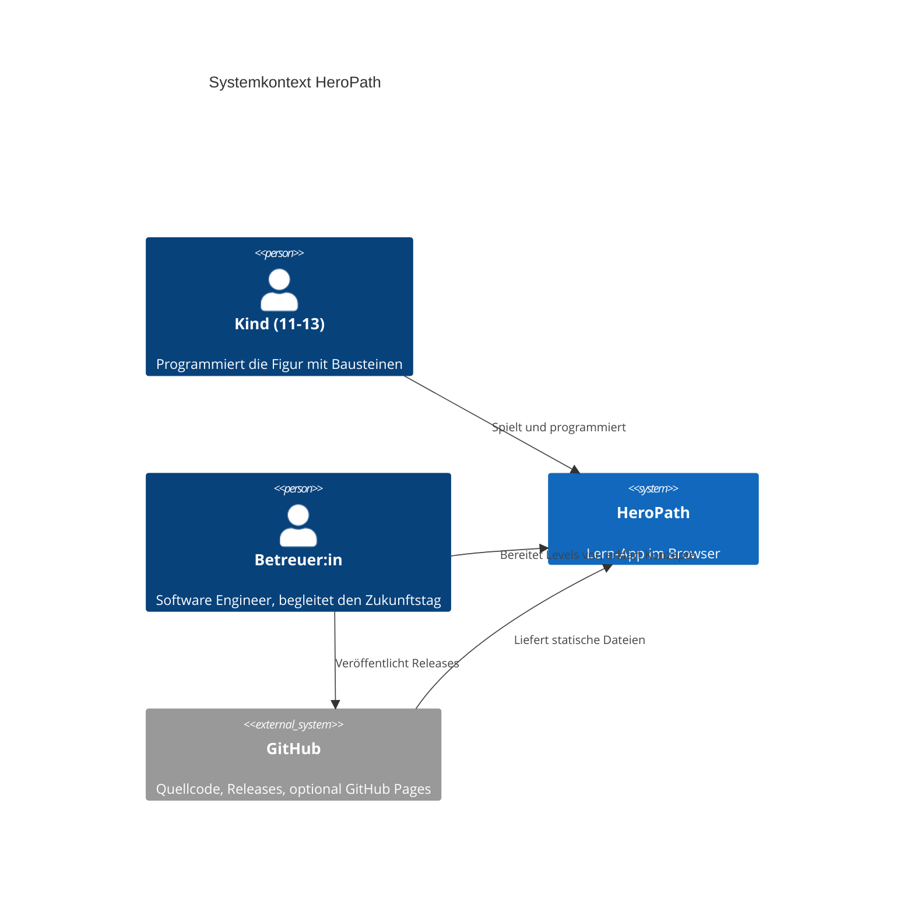
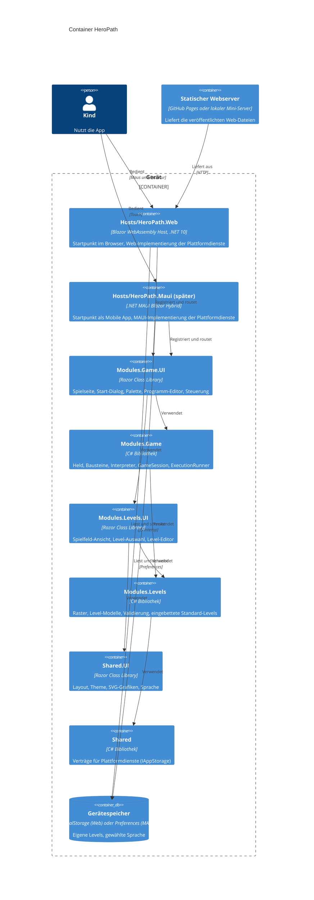
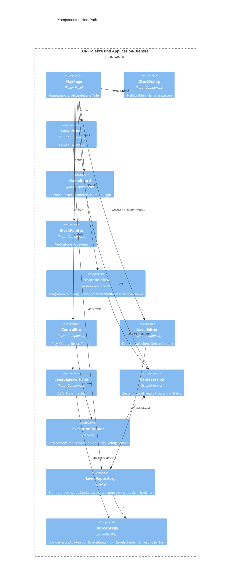
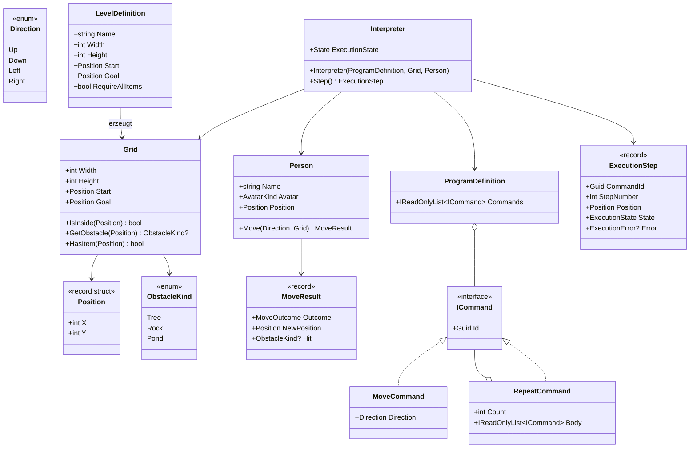
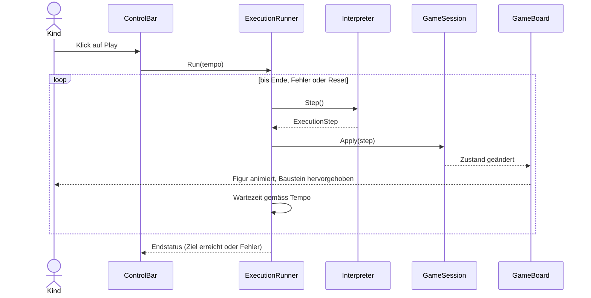
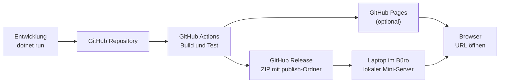

# HeroPath – Architektur (C4)

Die Diagramme sind in Mermaid geschrieben und werden auf GitHub direkt dargestellt.

## 1. Qualitätsziele

| Ziel | Massnahme |
|---|---|
| Einfach und robust im Einsatz | Keine Server, keine Anmeldung, alles läuft im Browser |
| Offline-fähig | Keine CDN-Abhängigkeiten, alle Assets liegen lokal |
| Testbar | Spielregeln in reinen C#-Projekten der Module ohne UI-Abhängigkeit, Grenzen per Architekturtest geprüft |
| Modular | Fachliche Module (Levels, Game) mit klarer Abhängigkeitsrichtung, nach Clean Architecture geschichtet |
| Austauschbar | Drag & Drop und Speicherung hinter eigenen Schnittstellen |
| Wiederverwendbar | Alle Komponenten in Razor Class Libraries, nutzbar im Browser und später in einer MAUI-App |
| Datenschutz | Der Heldenname wird nur im Arbeitsspeicher gehalten, nicht gespeichert |

## 2. Ebene 1: Systemkontext



## 3. Ebene 2: Container

HeroPath ist modular nach Clean Architecture aufgebaut (inspiriert von MiniMate):

- **Module** bündeln eine Fachlichkeit. Jedes Modul besteht aus zwei Projekten: einer reinen C#-Bibliothek mit den Ordnern `Domain`, `Application` und `Infrastructure` (ohne Blazor) und einer Razor Class Library `.UI` mit Komponenten, Texten und der Registrierung `Add<X>Module()`.
- **Shared** enthält modulübergreifende Verträge (`IAppStorage`) und UI (Layout, Theme, Grafiken, Sprache).
- **Hosts** starten die App und liefern die Plattformdienste. Heute gibt es den Web-Host, ein MAUI-Host kann später ergänzt werden, ohne Module zu ändern.

| Modul | Fachlichkeit |
|---|---|
| `Levels` | Spielfeld (Raster, Positionen, Hindernisse, Items), Level-Definitionen, Validierung, Standard-Levels, eigene Levels, Level-Editor |
| `Game` | Held, Bausteine, Programm, Interpreter, Play/Debug/Reset, Spielseite |

Abhängigkeitsrichtung: `Shared ← Levels ← Game`, für die `.UI`-Projekte gleich. Jedes `.UI`-Projekt kennt sein Modul, Hosts kennen alle `.UI`-Projekte. Reine Projekte referenzieren nie Blazor. `tests/HeroPath.ArchitectureTests` prüft diese Regeln automatisch.



## 4. Ebene 3: Komponenten

### 4.1 Komponenten und Dienste

Zuordnung zu den Projekten: `PlayPage`, `StartDialog`, `BlockPalette`, `ProgramEditor`, `ControlBar` liegen in `Modules.Game.UI`. `GameBoard`, `LevelPicker` und `LevelEditor` liegen in `Modules.Levels.UI`, `LanguageSwitcher` in `Shared.UI`. `GameSession` und `ExecutionRunner` liegen in `Modules.Game/Application`, `LevelRepository` in `Modules.Levels/Application`, `IAppStorage` in `Shared/Application/Contracts`.



### 4.2 Domain-Modell (Modules.Levels und Modules.Game)

`Position`, `ObstacleKind`, `Grid` und `LevelDefinition` gehören zu `Modules.Levels/Domain`. `Direction`, `Person`, `MoveResult`, die Befehle, `ProgramDefinition`, `Interpreter` und `ExecutionStep` gehören zu `Modules.Game/Domain`.



### 4.3 MAUI-Bereitschaft (Plattform-Abstraktion)

Die Oberfläche wird so gebaut, dass später ein .NET-MAUI-Blazor-Hybrid-Projekt (`Hosts/HeroPath.Maui`) angehängt werden kann. Es registriert dieselben Module (`AddSharedUI().AddLevelsModule().AddGameModule()`). Das MAUI-Projekt enthält dann nur den Startcode und die MAUI-Implementierungen der Plattformdienste. Es wird erst nach dem Zukunftstag umgesetzt.

| Thema | Web (heute) | MAUI (später) | Abstraktion |
|---|---|---|---|
| Speicher | localStorage über JS Interop | Preferences oder Dateisystem | `IAppStorage` |
| Standard-Levels | Eingebettete JSON-Ressourcen in `Modules.Levels` | gleich | keine nötig |
| Sprache | `CultureInfo` plus `IAppStorage` | gleich | `IAppStorage` |
| Level-Export und -Import | Datei-Download per JS | Teilen oder Dateiauswahl | `ILevelFileService` (Could) |
| Bedienung | Maus, HTML5 Drag & Drop | Touch im WebView | Klick-zum-Hinzufügen als Alternative |
| Layout | Desktop-first | Hochformat, kleine Bildschirme | Responsives CSS |
| Start | `index.html` mit Webserver | `BlazorWebView` | nur im Host-Projekt |

**Regeln für Komponenten:**

1. Alle Komponenten, Styles, Grafiken und Texte liegen in den `.UI`-Projekten der Module oder in `Shared.UI`. Die Hosts enthalten nur Startcode, die Registrierung der Module und die Plattformdienste.
2. Komponenten greifen nie direkt auf `localStorage`, `window`, das Dateisystem oder relative `HttpClient`-Adressen zu. Sie verwenden die Schnittstellen.
3. Jede Drag-&-Drop-Aktion hat eine Alternative per Klick oder Tipp. HTML5 Drag & Drop ist auf Touch-Geräten im WebView unzuverlässig.
4. Das Layout ist responsiv (CSS Grid, relative Einheiten, Container Queries), keine festen Pixelbreiten. Tippflächen sind mindestens 44 px gross.
5. Statische Dateien werden über den Pfad `_content/<Projektname>/...` eingebunden, z. B. `_content/HeroPath.Shared.UI/css/theme.css`.
6. Die reinen Projekte (`Shared`, `Modules.Levels`, `Modules.Game`) bleiben ohne Plattform- und Blazor-Abhängigkeit.

Hinweise: Der iOS-Build braucht einen Mac. Ob Fluent UI Blazor im Hybrid-Betrieb alle verwendeten Komponenten unterstützt, wird beim Anhängen des MAUI-Hosts geprüft.

## 5. Ablauf: Play und Debug

Play und Debug verwenden denselben Interpreter. Play ruft `Step()` in einer Schleife auf, Debug ruft es einmal pro Klick auf.



## 6. Entscheidungen

| Nr. | Entscheidung | Begründung | Alternative |
|---|---|---|---|
| 1 | Blazor WebAssembly, rein clientseitig | Kein Server nötig, läuft lokal und auf GitHub Pages | Blazor Server |
| 2 | Modulare Clean Architecture: Module `Levels` und `Game` plus `Shared`, je ein reines C#-Projekt (`Domain`/`Application`/`Infrastructure`) und ein `.UI`-Projekt | Fachliche Grenzen, Spielregeln ohne UI testbar, Erweiterung um neue Module (z. B. Themenwelten) ohne Umbau. Inspiriert von MiniMate, aber mit Fachlogik ausserhalb von Razor-Projekten | Drei Schichten Core/UI/Web; ein Razor-Projekt pro Modul (wie MiniMate); vier Projekte pro Modul |
| 2a | Oberfläche in Razor Class Libraries, Hosts nur zum Starten | Gleiche Komponenten im Browser und später in MAUI | Komponenten direkt im Web-Projekt |
| 2b | Abhängigkeitsregeln als automatischer Test (`HeroPath.ArchitectureTests`, liest DLL-Metadaten) | Grenzen bleiben auch bei KI-generiertem Code eingehalten | Nur Code-Review; NetArchTest-Paket |
| 3 | Ein Interpreter für Play und Debug | Weniger Code, gleiches Verhalten | Zwei getrennte Ausführungswege |
| 4 | Native HTML5 Drag & Drop in eigener Komponente, dazu Klick-zum-Hinzufügen | Keine Abhängigkeit, Maus genügt heute, Klick funktioniert auch auf Touch | SortableJS-Wrapper, MudBlazor DropZone, Blockly, Pointer Events |
| 5 | Raster mit CSS Grid, Figuren und Items als SVG | Einfach, skalierbar, Animation mit CSS-Transitions | Canvas |
| 6 | Fluent UI nur für Dialoge, Auswahl, Slider, Buttons | Bekannt, wenig Aufwand, eigenes verspieltes Styling darüber | Reines eigenes CSS |
| 7 | Lokalisierung mit `IStringLocalizer` und resx (de, en), inkl. Anzeigename (HeldenWeg / Hero's Path) | Standard in .NET | Eigene JSON-Texte |
| 8 | Level als JSON, Standard-Levels als eingebettete Ressourcen in `Modules.Levels` | Lesbar, exportierbar, funktioniert in jedem Host | Dateien in `wwwroot` per HttpClient |
| 9 | Speicherung hinter `IAppStorage`, Web-Implementierung mit localStorage | Reicht für den Einsatz, MAUI kann eigene Implementierung liefern | Keine Speicherung |
| 10 | E2E-Tests mit Playwright für .NET, Screenshots (normal und Graustufen) werden von einem Agenten visuell geprüft | Reproduzierbar, läuft in CI, ohne Node; prüft Layout und Farbenblind-Tauglichkeit | Nur manuell im Browser; Playwright MCP; nativer VS-Code-Browser (nur für Copilot steuerbar) |

## 7. Deployment



Wichtig: Eine Blazor-WebAssembly-App läuft nicht per Doppelklick auf `index.html` (`file://`). Sie braucht einen Webserver. Optionen für den lokalen Einsatz:

1. **GitHub Pages** (kein Install, nur URL öffnen, falls das Netz es zulässt).
2. **Mini-Host** (kleines ASP.NET-Core-Projekt, das nur statische Dateien ausliefert, als selbständige EXE mit `Start.bat`).
3. **Beliebiger statischer Server**, z. B. `python -m http.server` im publish-Ordner.

## 8. Teststrategie

| Ebene | Werkzeug | Inhalt |
|---|---|---|
| Domain/Application (`HeroPath.Modules.<X>.Tests`) | xUnit | Bewegung, Hindernisse, Rand, Wiederhole (auch verschachtelt), Items, Ziel, Schrittlimit, Level-Validierung, Lösbarkeit der Standard-Levels |
| Komponenten (`HeroPath.Modules.<X>.Tests`) | bUnit | `ProgramEditor` (Bausteine hinzufügen, entfernen, verschachteln), `ControlBar`, `GameBoard` Darstellung, Sprachumschaltung |
| Architektur (`HeroPath.ArchitectureTests`) | xUnit | Abhängigkeitsrichtung der Module, reine Projekte ohne Blazor |
| End-to-End (`HeroPath.E2E`) | Playwright (.NET) | Abläufe über mehrere Komponenten, Browserfehler, Screenshots für den visuellen Check. Läuft nur mit `HEROPATH_E2E=1` |
| Manuell | Browser | Drag & Drop, Animation, Probelauf auf dem Ziel-Laptop |

## 9. Ordnerstruktur

Im Root liegen nur `README.md`, die Solution-Datei `HeroPath.slnx` und die Repo-Dateien. Der Code liegt in `src/` und `tests/`, die Dokumentation in `docs/`.

```text
HeroPath/
├─ README.md                  Kurzbeschreibung, Start, Build, Lizenz
├─ HeroPath.slnx              Solution (XML-Format, Standard ab .NET 10 SDK)
├─ LICENSE                    MIT
├─ .gitignore
├─ Directory.Build.props      Gemeinsame Build-Einstellungen
├─ Directory.Packages.props   Zentrale Paketversionen
├─ src/
│  ├─ Shared/
│  │  ├─ HeroPath.Shared/              Verträge für Plattformdienste (IAppStorage)
│  │  └─ HeroPath.Shared.UI/           Layout, NotFound, Theme, SVG-Grafiken, Sprache
│  ├─ Modules/
│  │  ├─ Levels/
│  │  │  ├─ HeroPath.Modules.Levels/     Domain, Application, Infrastructure (eingebettete Standard-Levels)
│  │  │  └─ HeroPath.Modules.Levels.UI/  Spielfeld-Ansicht, Level-Auswahl, Level-Editor, Texte
│  │  └─ Game/
│  │     ├─ HeroPath.Modules.Game/       Domain (Held, Bausteine, Interpreter), Application (GameSession, ExecutionRunner)
│  │     └─ HeroPath.Modules.Game.UI/    Spielseite, Palette, Programm-Editor, Steuerung, Texte
│  └─ Hosts/
│     ├─ HeroPath.Web/                 Blazor WebAssembly Host (Program.cs, App.razor, index.html, Web-Dienste)
│     ├─ HeroPath.Maui/                (später) MAUI Blazor Hybrid Host
│     └─ HeroPath.Host/                (optional) Mini-Webserver für den lokalen Einsatz
├─ tests/
│  ├─ HeroPath.Modules.Levels.Tests/   xUnit + bUnit
│  ├─ HeroPath.Modules.Game.Tests/     xUnit + bUnit
│  ├─ HeroPath.ArchitectureTests/      Abhängigkeitsregeln
│  └─ HeroPath.E2E/                    Playwright, Screenshots nach artifacts/screenshots
└─ docs/
   ├─ Projektidee.md
   ├─ Architektur C4.md
   └─ Projekt_Kontext.md
```
